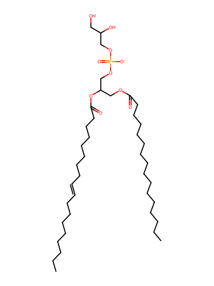
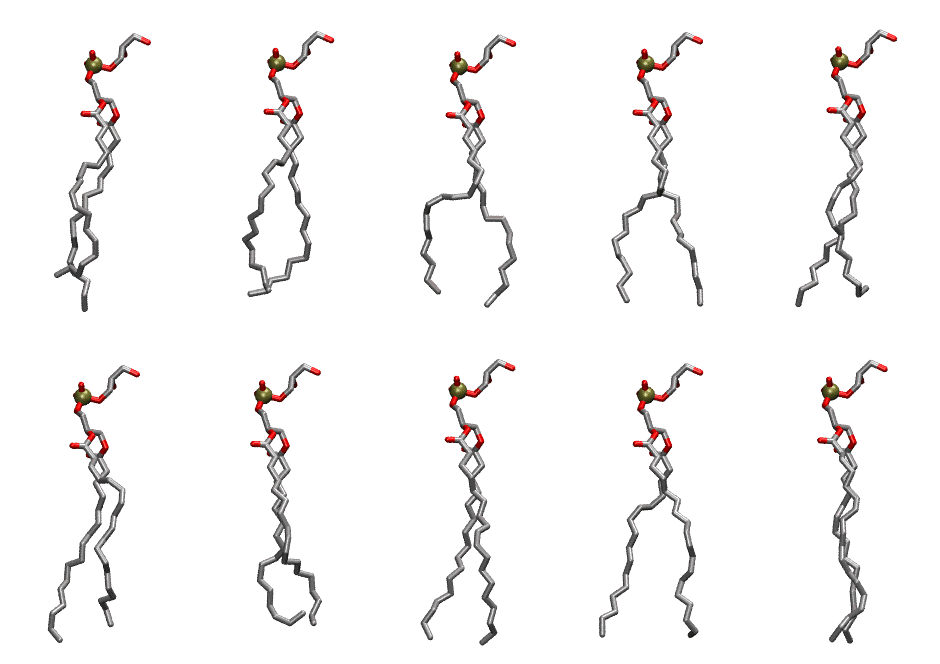

.. _lipid_gallery popg:

POPG
====

**3-palmitoyl-2-oleoyl-D-glycero-1-Phosphatidylglycerol**

==============  =======================
CHARMM resname  ``POPG``
Net charge      -1.00
Atoms           127
Topology file   ``top_all36_lipid.rtf``
Conformers      10 fluid
==============  =======================

Structure
---------

Conformers
----------

The grid packer draws a conformer per lipid from this ensemble, so what the ensemble contains is what a built bilayer is made of. A leaflet declared ``phase: Lo`` generates an ordered ensemble when a build first needs it. All conformers are rendered at one shared scale.

===========  =============  ================  ================
Conformer    Head-tail (Å)  Max internal (Å)  Min chain extent
===========  =============  ================  ================
``POPG-00``  14.18          27.61             0.69
``POPG-01``  15.79          27.77             0.77
``POPG-02``  15.58          26.81             0.76
``POPG-03``  16.64          28.49             0.81
``POPG-04``  15.74          28.15             0.77
``POPG-05``  15.80          28.27             0.77
``POPG-06``  14.94          27.08             0.77
``POPG-07``  17.58          28.43             0.87
``POPG-08``  16.93          28.27             0.82
``POPG-09``  17.69          29.43             0.86
===========  =============  ================  ================

*Min chain extent* is how far the least-extended acyl chain descends below its own attachment carbon, as a fraction of that chain's all-trans contour; an all-trans chain scores 1.0, and a conformer under 0.25 is rejected at generation as folded.

Provenance
----------

How the ensemble was generated, read from the entry's own ``info.yaml``:

===================  ============
Setting              ``POPG``
===================  ============
Sampler              ``mc``
Phase                none (fluid)
Trans bias           0.0
Chain order          0.255
MC seed              0
Chains               2
Cylinder APL         60.0 Ų
Cylinder inflation   1.9
Equilibration steps  20000
Decorrelation steps  3000
Max MC angle         30°
Radius scale         0.8
Axial bias           1.0
===================  ============
