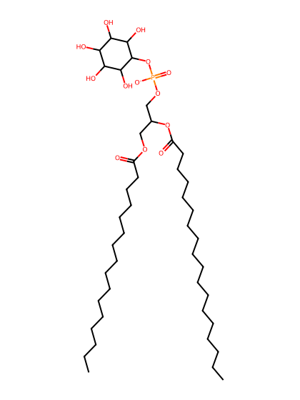
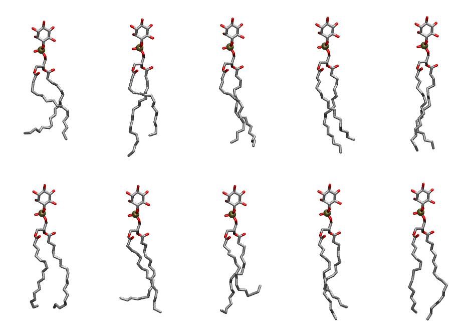

.. _lipid_gallery popi:

POPI
====

**1-Palmitoyl-2-Oleoyl-inositol**

==============  ===================================
CHARMM resname  ``POPI``
Net charge      -1.00
Atoms           137
Topology file   ``toppar_all36_lipid_inositol.str``
Conformers      10 fluid
==============  ===================================

Structure
---------

Conformers
----------

The grid packer draws a conformer per lipid from this ensemble, so what the ensemble contains is what a built bilayer is made of. A leaflet declared ``phase: Lo`` generates an ordered ensemble when a build first needs it. All conformers are rendered at one shared scale.

===========  =============  ================  ================
Conformer    Head-tail (Å)  Max internal (Å)  Min chain extent
===========  =============  ================  ================
``POPI-00``  13.21          27.53             0.62
``POPI-01``  14.19          32.07             0.72
``POPI-02``  15.90          29.97             0.78
``POPI-03``  15.47          31.68             0.79
``POPI-04``  17.47          30.88             0.82
``POPI-05``  15.27          29.57             0.73
``POPI-06``  13.34          29.78             0.63
``POPI-07``  10.69          30.07             0.54
``POPI-08``  15.58          31.66             0.79
``POPI-09``  16.92          32.11             0.86
===========  =============  ================  ================

*Min chain extent* is how far the least-extended acyl chain descends below its own attachment carbon, as a fraction of that chain's all-trans contour; an all-trans chain scores 1.0, and a conformer under 0.25 is rejected at generation as folded.

Provenance
----------

How the ensemble was generated, read from the entry's own ``info.yaml``:

===================  ============
Setting              ``POPI``
===================  ============
Sampler              ``mc``
Phase                none (fluid)
Trans bias           0.0
Chain order          0.220
MC seed              0
Chains               2
Cylinder APL         60.0 Ų
Cylinder inflation   1.9
Equilibration steps  20000
Decorrelation steps  3000
Max MC angle         30°
Radius scale         0.8
Axial bias           1.0
===================  ============
