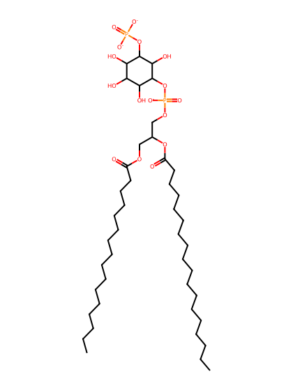
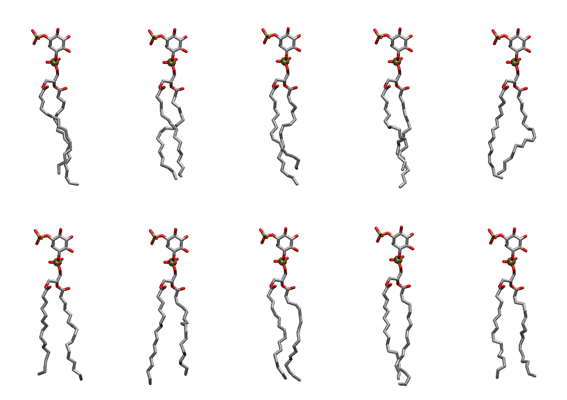

.. _lipid_gallery popi13:

POPI13
======

**1-Palmitoyl-2-Oleoyl-inositol-(3)-phosphate (PIP1)**

==============  ===================================
CHARMM resname  ``POPI13``
Net charge      -3.00
Atoms           140
Topology file   ``toppar_all36_lipid_inositol.str``
Conformers      10 fluid
==============  ===================================

Structure
---------

Conformers
----------

The grid packer draws a conformer per lipid from this ensemble, so what the ensemble contains is what a built bilayer is made of. A leaflet declared ``phase: Lo`` generates an ordered ensemble when a build first needs it. All conformers are rendered at one shared scale.

=============  =============  ================  ================
Conformer      Head-tail (Å)  Max internal (Å)  Min chain extent
=============  =============  ================  ================
``POPI13-00``  16.21          31.49             0.83
``POPI13-01``  16.69          29.99             0.78
``POPI13-02``  15.42          31.75             0.80
``POPI13-03``  15.65          32.14             0.81
``POPI13-04``  16.27          30.40             0.74
``POPI13-05``  16.36          30.60             0.79
``POPI13-06``  16.42          31.61             0.75
``POPI13-07``  17.32          30.92             0.80
``POPI13-08``  17.67          31.78             0.85
``POPI13-09``  16.84          30.30             0.76
=============  =============  ================  ================

*Min chain extent* is how far the least-extended acyl chain descends below its own attachment carbon, as a fraction of that chain's all-trans contour; an all-trans chain scores 1.0, and a conformer under 0.25 is rejected at generation as folded.

Provenance
----------

How the ensemble was generated, read from the entry's own ``info.yaml``:

===================  ============
Setting              ``POPI13``
===================  ============
Sampler              ``mc``
Phase                none (fluid)
Trans bias           0.0
Chain order          0.251
MC seed              0
Chains               2
Cylinder APL         60.0 Ų
Cylinder inflation   1.9
Equilibration steps  20000
Decorrelation steps  3000
Max MC angle         30°
Radius scale         0.8
Axial bias           1.0
===================  ============
