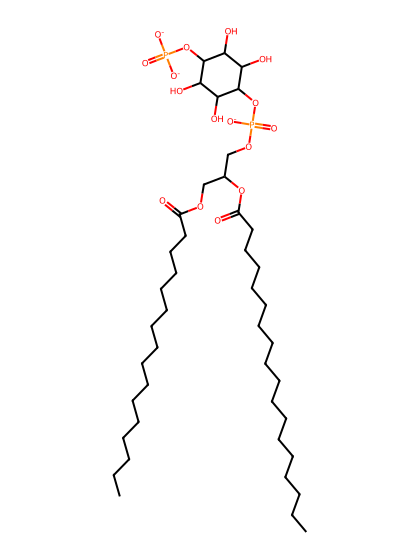
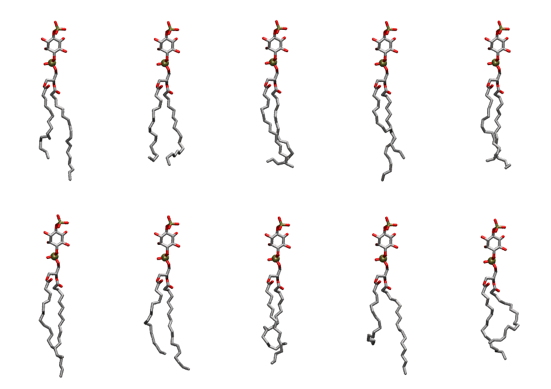

.. _lipid_gallery popi14:

POPI14
======

**1-Palmitoyl-2-Oleoyl-inositol-(4)-phosphate (PIP1)**

==============  ===================================
CHARMM resname  ``POPI14``
Net charge      -3.00
Atoms           140
Topology file   ``toppar_all36_lipid_inositol.str``
Conformers      10 fluid
==============  ===================================

Structure
---------

Conformers
----------

The grid packer draws a conformer per lipid from this ensemble, so what the ensemble contains is what a built bilayer is made of. A leaflet declared ``phase: Lo`` generates an ordered ensemble when a build first needs it. All conformers are rendered at one shared scale.

=============  =============  ================  ================
Conformer      Head-tail (Å)  Max internal (Å)  Min chain extent
=============  =============  ================  ================
``POPI14-00``  13.53          33.89             0.76
``POPI14-01``  13.37          30.22             0.71
``POPI14-02``  14.42          31.43             0.69
``POPI14-03``  13.48          34.28             0.75
``POPI14-04``  14.19          31.61             0.75
``POPI14-05``  14.68          34.64             0.82
``POPI14-06``  13.74          33.12             0.77
``POPI14-07``  11.42          31.44             0.55
``POPI14-08``  10.58          33.75             0.60
``POPI14-09``  10.78          30.37             0.52
=============  =============  ================  ================

*Min chain extent* is how far the least-extended acyl chain descends below its own attachment carbon, as a fraction of that chain's all-trans contour; an all-trans chain scores 1.0, and a conformer under 0.25 is rejected at generation as folded.

Provenance
----------

How the ensemble was generated, read from the entry's own ``info.yaml``:

===================  ============
Setting              ``POPI14``
===================  ============
Sampler              ``mc``
Phase                none (fluid)
Trans bias           0.0
Chain order          0.208
MC seed              0
Chains               2
Cylinder APL         60.0 Ų
Cylinder inflation   1.9
Equilibration steps  20000
Decorrelation steps  3000
Max MC angle         30°
Radius scale         0.8
Axial bias           1.0
===================  ============
