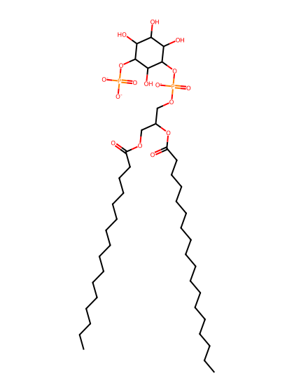
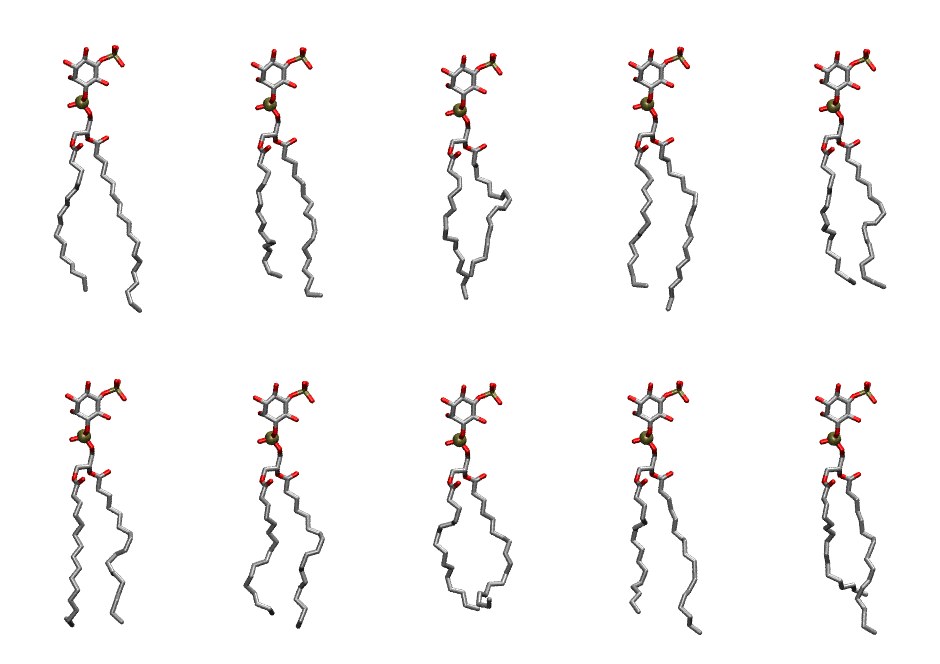

.. _lipid_gallery popi15:

POPI15
======

**1-Palmitoyl-2-Oleoyl-inositol-(5)-phosphate (PIP1)**

==============  ===================================
CHARMM resname  ``POPI15``
Net charge      -3.00
Atoms           140
Topology file   ``toppar_all36_lipid_inositol.str``
Conformers      10 fluid
==============  ===================================

Structure
---------

Conformers
----------

The grid packer draws a conformer per lipid from this ensemble, so what the ensemble contains is what a built bilayer is made of. A leaflet declared ``phase: Lo`` generates an ordered ensemble when a build first needs it. All conformers are rendered at one shared scale.

=============  =============  ================  ================
Conformer      Head-tail (Å)  Max internal (Å)  Min chain extent
=============  =============  ================  ================
``POPI15-00``  16.86          33.02             0.86
``POPI15-01``  15.05          30.55             0.76
``POPI15-02``  14.21          30.12             0.67
``POPI15-03``  16.21          32.62             0.82
``POPI15-04``  15.63          29.44             0.76
``POPI15-05``  16.33          30.26             0.79
``POPI15-06``  15.44          30.92             0.78
``POPI15-07``  13.60          28.54             0.64
``POPI15-08``  15.30          30.92             0.77
``POPI15-09``  13.16          30.99             0.66
=============  =============  ================  ================

*Min chain extent* is how far the least-extended acyl chain descends below its own attachment carbon, as a fraction of that chain's all-trans contour; an all-trans chain scores 1.0, and a conformer under 0.25 is rejected at generation as folded.

Provenance
----------

How the ensemble was generated, read from the entry's own ``info.yaml``:

===================  ============
Setting              ``POPI15``
===================  ============
Sampler              ``mc``
Phase                none (fluid)
Trans bias           0.0
Chain order          0.211
MC seed              0
Chains               2
Cylinder APL         60.0 Ų
Cylinder inflation   1.9
Equilibration steps  20000
Decorrelation steps  3000
Max MC angle         30°
Radius scale         0.8
Axial bias           1.0
===================  ============
