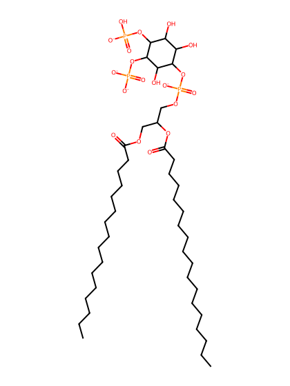
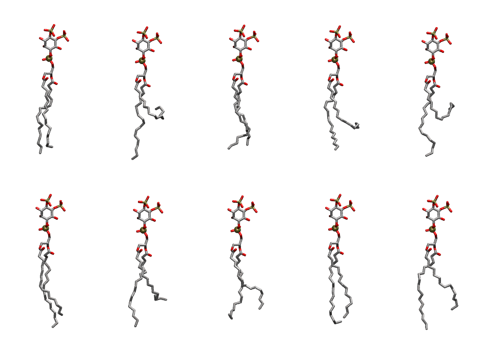

.. _lipid_gallery popi24:

POPI24
======

**1-Palmitoyl-2-Oleoyl-inositol-(4,5)-bisphosphate (PIP2) with protonation on P4**

==============  ===================================
CHARMM resname  ``POPI24``
Net charge      -4.00
Atoms           144
Topology file   ``toppar_all36_lipid_inositol.str``
Conformers      10 fluid
==============  ===================================

Structure
---------

Conformers
----------

The grid packer draws a conformer per lipid from this ensemble, so what the ensemble contains is what a built bilayer is made of. A leaflet declared ``phase: Lo`` generates an ordered ensemble when a build first needs it. All conformers are rendered at one shared scale.

=============  =============  ================  ================
Conformer      Head-tail (Å)  Max internal (Å)  Min chain extent
=============  =============  ================  ================
``POPI24-00``  15.45          32.77             0.80
``POPI24-01``  5.63           33.90             0.34
``POPI24-02``  14.76          31.58             0.75
``POPI24-03``  10.39          30.97             0.59
``POPI24-04``  5.44           32.26             0.33
``POPI24-05``  14.94          33.62             0.82
``POPI24-06``  10.76          32.52             0.60
``POPI24-07``  13.06          31.05             0.69
``POPI24-08``  15.56          33.26             0.79
``POPI24-09``  13.33          33.63             0.74
=============  =============  ================  ================

*Min chain extent* is how far the least-extended acyl chain descends below its own attachment carbon, as a fraction of that chain's all-trans contour; an all-trans chain scores 1.0, and a conformer under 0.25 is rejected at generation as folded.

Provenance
----------

How the ensemble was generated, read from the entry's own ``info.yaml``:

===================  ============
Setting              ``POPI24``
===================  ============
Sampler              ``mc``
Phase                none (fluid)
Trans bias           0.0
Chain order          0.195
MC seed              0
Chains               2
Cylinder APL         60.0 Ų
Cylinder inflation   1.9
Equilibration steps  20000
Decorrelation steps  3000
Max MC angle         30°
Radius scale         0.8
Axial bias           1.0
===================  ============
