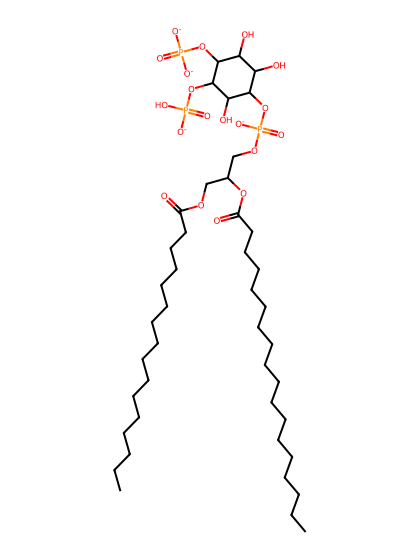
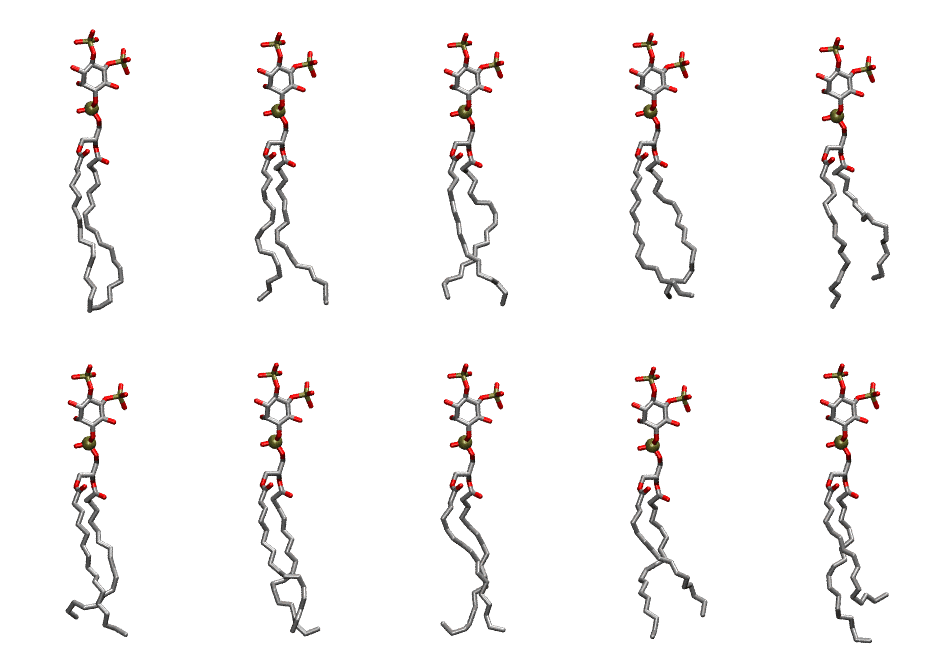

.. _lipid_gallery popi25:

POPI25
======

**1-Palmitoyl-2-Oleoyl-inositol-(4,5)-bisphosphate (PIP2) with protonation on P5**

==============  ===================================
CHARMM resname  ``POPI25``
Net charge      -4.00
Atoms           144
Topology file   ``toppar_all36_lipid_inositol.str``
Conformers      10 fluid
==============  ===================================

Structure
---------

Conformers
----------

The grid packer draws a conformer per lipid from this ensemble, so what the ensemble contains is what a built bilayer is made of. A leaflet declared ``phase: Lo`` generates an ordered ensemble when a build first needs it. All conformers are rendered at one shared scale.

=============  =============  ================  ================
Conformer      Head-tail (Å)  Max internal (Å)  Min chain extent
=============  =============  ================  ================
``POPI25-00``  16.67          32.82             0.79
``POPI25-01``  15.29          32.32             0.75
``POPI25-02``  14.98          31.80             0.71
``POPI25-03``  14.80          31.88             0.71
``POPI25-04``  12.31          31.54             0.59
``POPI25-05``  13.65          31.64             0.65
``POPI25-06``  15.21          32.02             0.73
``POPI25-07``  14.52          31.56             0.69
``POPI25-08``  13.14          31.59             0.72
``POPI25-09``  11.21          33.17             0.62
=============  =============  ================  ================

*Min chain extent* is how far the least-extended acyl chain descends below its own attachment carbon, as a fraction of that chain's all-trans contour; an all-trans chain scores 1.0, and a conformer under 0.25 is rejected at generation as folded.

Provenance
----------

How the ensemble was generated, read from the entry's own ``info.yaml``:

===================  ============
Setting              ``POPI25``
===================  ============
Sampler              ``mc``
Phase                none (fluid)
Trans bias           0.0
Chain order          0.193
MC seed              0
Chains               2
Cylinder APL         60.0 Ų
Cylinder inflation   1.9
Equilibration steps  20000
Decorrelation steps  3000
Max MC angle         30°
Radius scale         0.8
Axial bias           1.0
===================  ============
