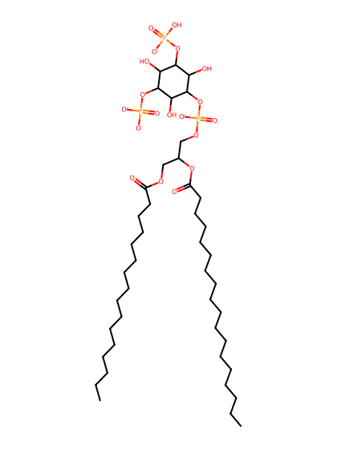
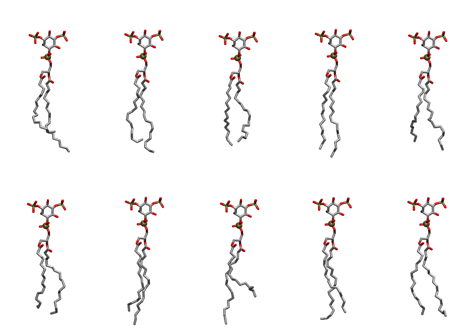

.. _lipid_gallery popi2a:

POPI2A
======

**1-Palmitoyl-2-Oleoyl-inositol-(3,5)-bisphosphate (PIP2) with protonation on P3**

==============  ===================================
CHARMM resname  ``POPI2A``
Net charge      -4.00
Atoms           144
Topology file   ``toppar_all36_lipid_inositol.str``
Conformers      10 fluid
==============  ===================================

Structure
---------

Conformers
----------

The grid packer draws a conformer per lipid from this ensemble, so what the ensemble contains is what a built bilayer is made of. A leaflet declared ``phase: Lo`` generates an ordered ensemble when a build first needs it. All conformers are rendered at one shared scale.

=============  =============  ================  ================
Conformer      Head-tail (Å)  Max internal (Å)  Min chain extent
=============  =============  ================  ================
``POPI2A-00``  12.11          32.20             0.68
``POPI2A-01``  14.24          32.18             0.80
``POPI2A-02``  14.24          29.62             0.68
``POPI2A-03``  16.65          33.64             0.89
``POPI2A-04``  14.38          31.46             0.78
``POPI2A-05``  13.54          31.00             0.73
``POPI2A-06``  15.23          33.01             0.85
``POPI2A-07``  11.19          32.16             0.64
``POPI2A-08``  15.49          32.17             0.82
``POPI2A-09``  15.99          31.45             0.78
=============  =============  ================  ================

*Min chain extent* is how far the least-extended acyl chain descends below its own attachment carbon, as a fraction of that chain's all-trans contour; an all-trans chain scores 1.0, and a conformer under 0.25 is rejected at generation as folded.

Provenance
----------

How the ensemble was generated, read from the entry's own ``info.yaml``:

===================  ============
Setting              ``POPI2A``
===================  ============
Sampler              ``mc``
Phase                none (fluid)
Trans bias           0.0
Chain order          0.234
MC seed              0
Chains               2
Cylinder APL         60.0 Ų
Cylinder inflation   1.9
Equilibration steps  20000
Decorrelation steps  3000
Max MC angle         30°
Radius scale         0.8
Axial bias           1.0
===================  ============
