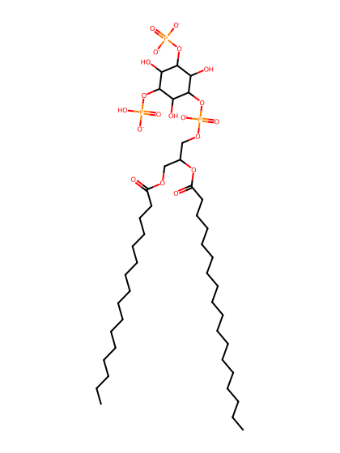
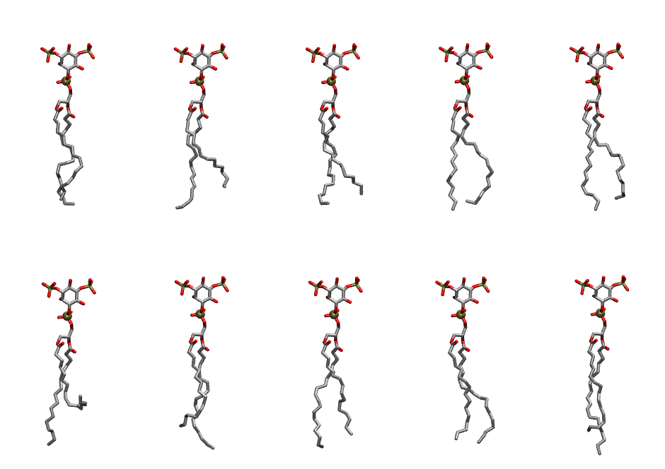

.. _lipid_gallery popi2b:

POPI2B
======

**1-Palmitoyl-2-Oleoyl-inositol-(3,5)-bisphosphate (PIP2) with protonation on P5**

==============  ===================================
CHARMM resname  ``POPI2B``
Net charge      -4.00
Atoms           144
Topology file   ``toppar_all36_lipid_inositol.str``
Conformers      10 fluid
==============  ===================================

Structure
---------

Conformers
----------

The grid packer draws a conformer per lipid from this ensemble, so what the ensemble contains is what a built bilayer is made of. A leaflet declared ``phase: Lo`` generates an ordered ensemble when a build first needs it. All conformers are rendered at one shared scale.

=============  =============  ================  ================
Conformer      Head-tail (Å)  Max internal (Å)  Min chain extent
=============  =============  ================  ================
``POPI2B-00``  14.54          29.98             0.73
``POPI2B-01``  12.27          30.66             0.69
``POPI2B-02``  13.50          29.51             0.72
``POPI2B-03``  14.95          30.53             0.71
``POPI2B-04``  14.40          30.45             0.69
``POPI2B-05``  7.79           30.98             0.38
``POPI2B-06``  13.40          31.65             0.75
``POPI2B-07``  14.74          31.54             0.81
``POPI2B-08``  15.59          30.56             0.77
``POPI2B-09``  14.34          32.51             0.80
=============  =============  ================  ================

*Min chain extent* is how far the least-extended acyl chain descends below its own attachment carbon, as a fraction of that chain's all-trans contour; an all-trans chain scores 1.0, and a conformer under 0.25 is rejected at generation as folded.

Provenance
----------

How the ensemble was generated, read from the entry's own ``info.yaml``:

===================  ============
Setting              ``POPI2B``
===================  ============
Sampler              ``mc``
Phase                none (fluid)
Trans bias           0.0
Chain order          0.221
MC seed              0
Chains               2
Cylinder APL         60.0 Ų
Cylinder inflation   1.9
Equilibration steps  20000
Decorrelation steps  3000
Max MC angle         30°
Radius scale         0.8
Axial bias           1.0
===================  ============
