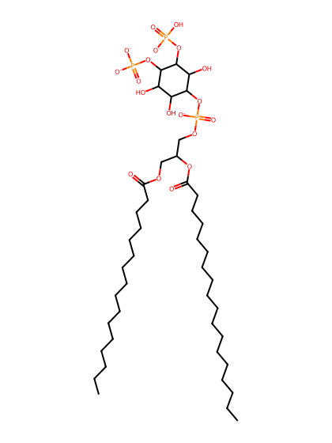
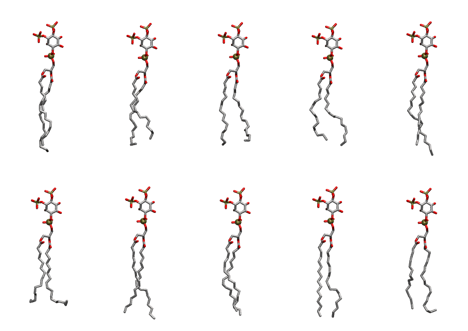

.. _lipid_gallery popi2c:

POPI2C
======

**1-Palmitoyl-2-Oleoyl-inositol-(3,4)-bisphosphate (PIP2) with protonation on P3**

==============  ===================================
CHARMM resname  ``POPI2C``
Net charge      -4.00
Atoms           144
Topology file   ``toppar_all36_lipid_inositol.str``
Conformers      10 fluid
==============  ===================================

Structure
---------

Conformers
----------

The grid packer draws a conformer per lipid from this ensemble, so what the ensemble contains is what a built bilayer is made of. A leaflet declared ``phase: Lo`` generates an ordered ensemble when a build first needs it. All conformers are rendered at one shared scale.

=============  =============  ================  ================
Conformer      Head-tail (Å)  Max internal (Å)  Min chain extent
=============  =============  ================  ================
``POPI2C-00``  16.22          34.23             0.85
``POPI2C-01``  14.22          32.23             0.74
``POPI2C-02``  14.90          32.03             0.71
``POPI2C-03``  14.43          31.83             0.75
``POPI2C-04``  16.12          34.78             0.89
``POPI2C-05``  13.46          30.68             0.66
``POPI2C-06``  16.75          34.51             0.87
``POPI2C-07``  16.14          33.10             0.82
``POPI2C-08``  17.74          33.95             0.85
``POPI2C-09``  15.42          32.83             0.76
=============  =============  ================  ================

*Min chain extent* is how far the least-extended acyl chain descends below its own attachment carbon, as a fraction of that chain's all-trans contour; an all-trans chain scores 1.0, and a conformer under 0.25 is rejected at generation as folded.

Provenance
----------

How the ensemble was generated, read from the entry's own ``info.yaml``:

===================  ============
Setting              ``POPI2C``
===================  ============
Sampler              ``mc``
Phase                none (fluid)
Trans bias           0.0
Chain order          0.264
MC seed              0
Chains               2
Cylinder APL         60.0 Ų
Cylinder inflation   1.9
Equilibration steps  20000
Decorrelation steps  3000
Max MC angle         30°
Radius scale         0.8
Axial bias           1.0
===================  ============
