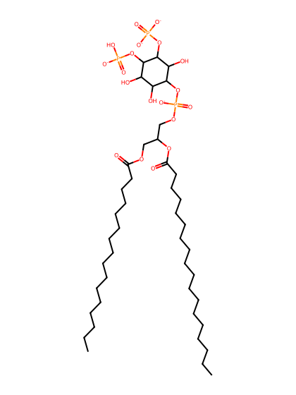
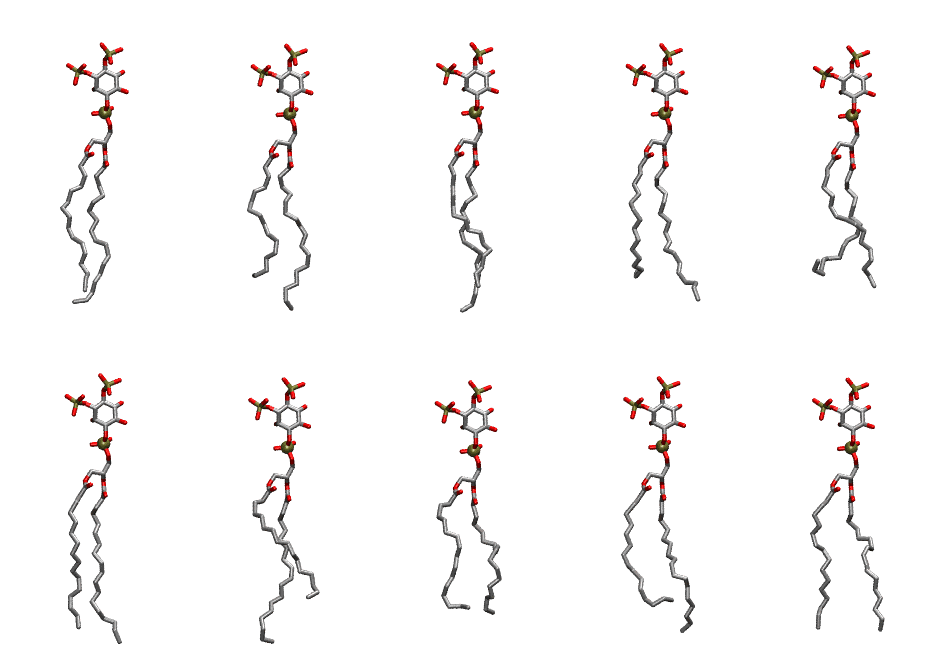

.. _lipid_gallery popi2d:

POPI2D
======

**1-Palmitoyl-2-Oleoyl-inositol-(3,4)-bisphosphate (PIP2) with protonation on P4**

==============  ===================================
CHARMM resname  ``POPI2D``
Net charge      -4.00
Atoms           144
Topology file   ``toppar_all36_lipid_inositol.str``
Conformers      10 fluid
==============  ===================================

Structure
---------

Conformers
----------

The grid packer draws a conformer per lipid from this ensemble, so what the ensemble contains is what a built bilayer is made of. A leaflet declared ``phase: Lo`` generates an ordered ensemble when a build first needs it. All conformers are rendered at one shared scale.

=============  =============  ================  ================
Conformer      Head-tail (Å)  Max internal (Å)  Min chain extent
=============  =============  ================  ================
``POPI2D-00``  15.54          33.10             0.81
``POPI2D-01``  13.60          33.99             0.77
``POPI2D-02``  15.06          34.36             0.85
``POPI2D-03``  13.18          32.47             0.75
``POPI2D-04``  11.62          30.46             0.56
``POPI2D-05``  16.30          34.05             0.86
``POPI2D-06``  12.12          33.83             0.69
``POPI2D-07``  13.00          30.10             0.65
``POPI2D-08``  12.60          32.55             0.72
``POPI2D-09``  15.82          32.07             0.77
=============  =============  ================  ================

*Min chain extent* is how far the least-extended acyl chain descends below its own attachment carbon, as a fraction of that chain's all-trans contour; an all-trans chain scores 1.0, and a conformer under 0.25 is rejected at generation as folded.

Provenance
----------

How the ensemble was generated, read from the entry's own ``info.yaml``:

===================  ============
Setting              ``POPI2D``
===================  ============
Sampler              ``mc``
Phase                none (fluid)
Trans bias           0.0
Chain order          0.222
MC seed              0
Chains               2
Cylinder APL         60.0 Ų
Cylinder inflation   1.9
Equilibration steps  20000
Decorrelation steps  3000
Max MC angle         30°
Radius scale         0.8
Axial bias           1.0
===================  ============
