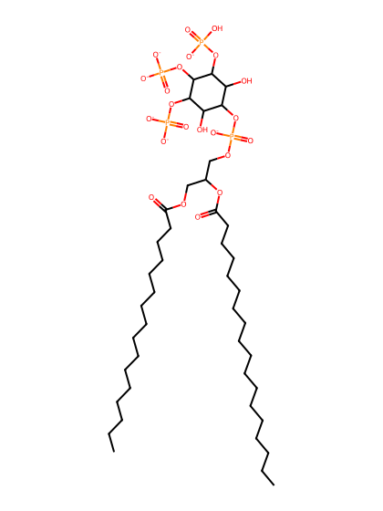
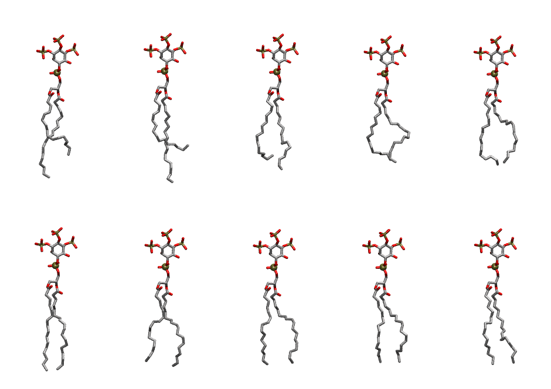

.. _lipid_gallery popi33:

POPI33
======

**1-Palmitoyl-2-Oleoyl-inositol-(3,4,5)-trisphosphate (PIP3) with protonation on P3**

==============  ===================================
CHARMM resname  ``POPI33``
Net charge      -6.00
Atoms           147
Topology file   ``toppar_all36_lipid_inositol.str``
Conformers      10 fluid
==============  ===================================

Structure
---------

Conformers
----------

The grid packer draws a conformer per lipid from this ensemble, so what the ensemble contains is what a built bilayer is made of. A leaflet declared ``phase: Lo`` generates an ordered ensemble when a build first needs it. All conformers are rendered at one shared scale.

=============  =============  ================  ================
Conformer      Head-tail (Å)  Max internal (Å)  Min chain extent
=============  =============  ================  ================
``POPI33-00``  12.33          33.70             0.70
``POPI33-01``  10.63          34.59             0.61
``POPI33-02``  12.73          31.75             0.72
``POPI33-03``  13.29          29.62             0.66
``POPI33-04``  13.84          30.20             0.66
``POPI33-05``  17.24          33.40             0.82
``POPI33-06``  15.11          32.42             0.77
``POPI33-07``  15.33          31.91             0.73
``POPI33-08``  15.19          31.24             0.72
``POPI33-09``  15.51          31.16             0.74
=============  =============  ================  ================

*Min chain extent* is how far the least-extended acyl chain descends below its own attachment carbon, as a fraction of that chain's all-trans contour; an all-trans chain scores 1.0, and a conformer under 0.25 is rejected at generation as folded.

Provenance
----------

How the ensemble was generated, read from the entry's own ``info.yaml``:

===================  ============
Setting              ``POPI33``
===================  ============
Sampler              ``mc``
Phase                none (fluid)
Trans bias           0.0
Chain order          0.230
MC seed              0
Chains               2
Cylinder APL         60.0 Ų
Cylinder inflation   1.9
Equilibration steps  20000
Decorrelation steps  3000
Max MC angle         30°
Radius scale         0.8
Axial bias           1.0
===================  ============
