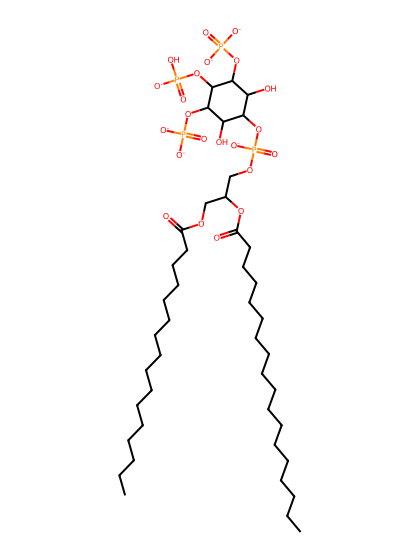
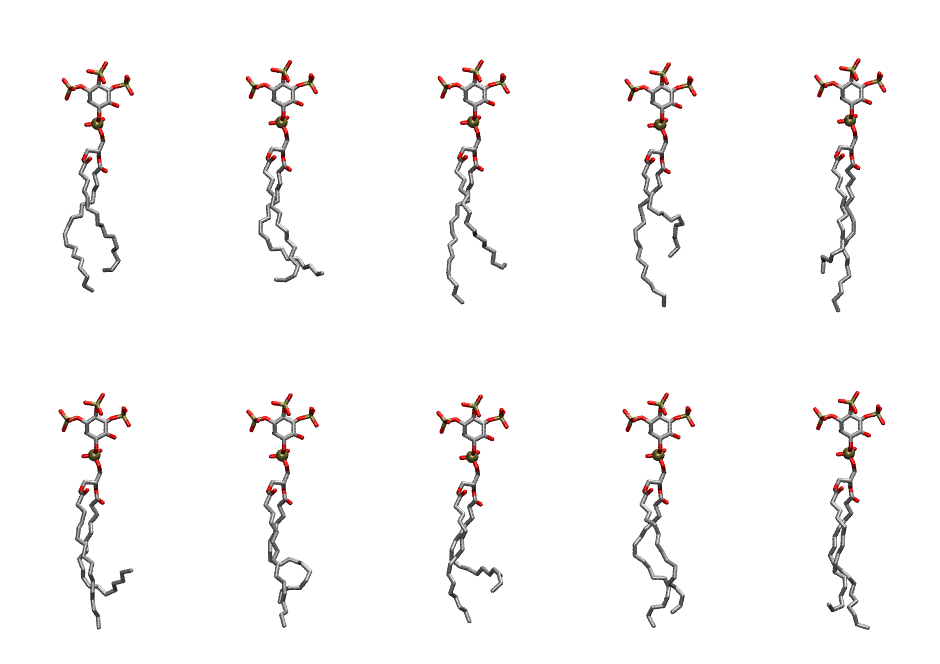

.. _lipid_gallery popi34:

POPI34
======

**1-Palmitoyl-2-Oleoyl-inositol-(3,4,5)-trisphosphate (PIP3) with protonation on P4**

==============  ===================================
CHARMM resname  ``POPI34``
Net charge      -6.00
Atoms           147
Topology file   ``toppar_all36_lipid_inositol.str``
Conformers      10 fluid
==============  ===================================

Structure
---------

Conformers
----------

The grid packer draws a conformer per lipid from this ensemble, so what the ensemble contains is what a built bilayer is made of. A leaflet declared ``phase: Lo`` generates an ordered ensemble when a build first needs it. All conformers are rendered at one shared scale.

=============  =============  ================  ================
Conformer      Head-tail (Å)  Max internal (Å)  Min chain extent
=============  =============  ================  ================
``POPI34-00``  13.29          31.54             0.76
``POPI34-01``  13.90          30.40             0.67
``POPI34-02``  12.80          33.35             0.73
``POPI34-03``  11.21          33.45             0.65
``POPI34-04``  13.94          35.32             0.79
``POPI34-05``  9.09           31.84             0.44
``POPI34-06``  13.29          31.71             0.64
``POPI34-07``  11.60          31.11             0.56
``POPI34-08``  14.68          32.77             0.79
``POPI34-09``  13.94          33.02             0.79
=============  =============  ================  ================

*Min chain extent* is how far the least-extended acyl chain descends below its own attachment carbon, as a fraction of that chain's all-trans contour; an all-trans chain scores 1.0, and a conformer under 0.25 is rejected at generation as folded.

Provenance
----------

How the ensemble was generated, read from the entry's own ``info.yaml``:

===================  ============
Setting              ``POPI34``
===================  ============
Sampler              ``mc``
Phase                none (fluid)
Trans bias           0.0
Chain order          0.230
MC seed              0
Chains               2
Cylinder APL         60.0 Ų
Cylinder inflation   1.9
Equilibration steps  20000
Decorrelation steps  3000
Max MC angle         30°
Radius scale         0.8
Axial bias           1.0
===================  ============
