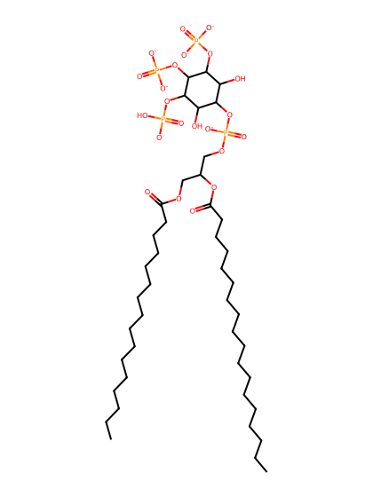
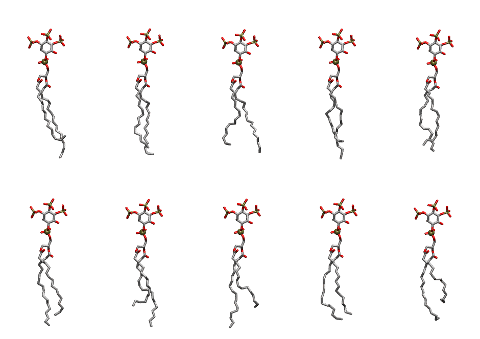

.. _lipid_gallery popi35:

POPI35
======

**1-Palmitoyl-2-Oleoyl-inositol-(3,4,5)-trisphosphate (PIP3) with protonation on P5**

==============  ===================================
CHARMM resname  ``POPI35``
Net charge      -6.00
Atoms           147
Topology file   ``toppar_all36_lipid_inositol.str``
Conformers      10 fluid
==============  ===================================

Structure
---------

Conformers
----------

The grid packer draws a conformer per lipid from this ensemble, so what the ensemble contains is what a built bilayer is made of. A leaflet declared ``phase: Lo`` generates an ordered ensemble when a build first needs it. All conformers are rendered at one shared scale.

=============  =============  ================  ================
Conformer      Head-tail (Å)  Max internal (Å)  Min chain extent
=============  =============  ================  ================
``POPI35-00``  12.51          33.80             0.71
``POPI35-01``  15.51          32.89             0.82
``POPI35-02``  14.52          32.25             0.79
``POPI35-03``  13.88          33.97             0.78
``POPI35-04``  14.53          31.74             0.76
``POPI35-05``  14.83          32.96             0.83
``POPI35-06``  12.30          33.20             0.70
``POPI35-07``  12.71          33.41             0.72
``POPI35-08``  14.56          32.02             0.76
``POPI35-09``  10.64          31.44             0.61
=============  =============  ================  ================

*Min chain extent* is how far the least-extended acyl chain descends below its own attachment carbon, as a fraction of that chain's all-trans contour; an all-trans chain scores 1.0, and a conformer under 0.25 is rejected at generation as folded.

Provenance
----------

How the ensemble was generated, read from the entry's own ``info.yaml``:

===================  ============
Setting              ``POPI35``
===================  ============
Sampler              ``mc``
Phase                none (fluid)
Trans bias           0.0
Chain order          0.207
MC seed              0
Chains               2
Cylinder APL         60.0 Ų
Cylinder inflation   1.9
Equilibration steps  20000
Decorrelation steps  3000
Max MC angle         30°
Radius scale         0.8
Axial bias           1.0
===================  ============
