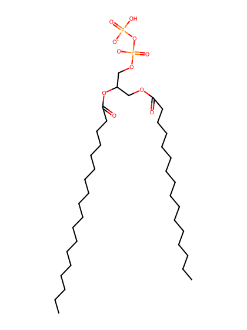
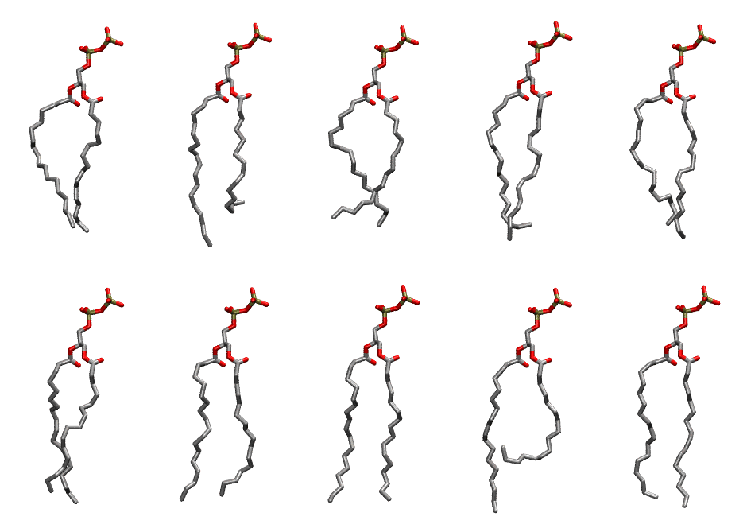

.. _lipid_gallery popp1:

POPP1
=====

**3-palmitoyl-2-oleoyl-D-glycero-1-Pyrophsphate**

==============  ========================================
CHARMM resname  ``POPP1``
Net charge      -2.00
Atoms           120
Topology file   ``toppar_all36_lipid_miscellaneous.str``
Conformers      10 fluid
==============  ========================================

Structure
---------

Conformers
----------

The grid packer draws a conformer per lipid from this ensemble, so what the ensemble contains is what a built bilayer is made of. A leaflet declared ``phase: Lo`` generates an ordered ensemble when a build first needs it. All conformers are rendered at one shared scale.

============  =============  ================  ================
Conformer     Head-tail (Å)  Max internal (Å)  Min chain extent
============  =============  ================  ================
``POPP1-00``  14.76          25.87             0.71
``POPP1-01``  12.32          28.05             0.66
``POPP1-02``  13.80          25.34             0.71
``POPP1-03``  15.24          27.62             0.74
``POPP1-04``  14.74          26.55             0.71
``POPP1-05``  15.20          27.29             0.80
``POPP1-06``  15.69          27.43             0.78
``POPP1-07``  16.47          28.31             0.80
``POPP1-08``  9.97           28.94             0.54
``POPP1-09``  16.16          27.34             0.78
============  =============  ================  ================

*Min chain extent* is how far the least-extended acyl chain descends below its own attachment carbon, as a fraction of that chain's all-trans contour; an all-trans chain scores 1.0, and a conformer under 0.25 is rejected at generation as folded.

Provenance
----------

How the ensemble was generated, read from the entry's own ``info.yaml``:

===================  ============
Setting              ``POPP1``
===================  ============
Sampler              ``mc``
Phase                none (fluid)
Trans bias           0.0
Chain order          0.218
MC seed              0
Chains               2
Cylinder APL         60.0 Ų
Cylinder inflation   1.9
Equilibration steps  20000
Decorrelation steps  3000
Max MC angle         30°
Radius scale         0.8
Axial bias           1.0
===================  ============
