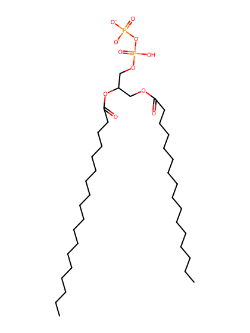
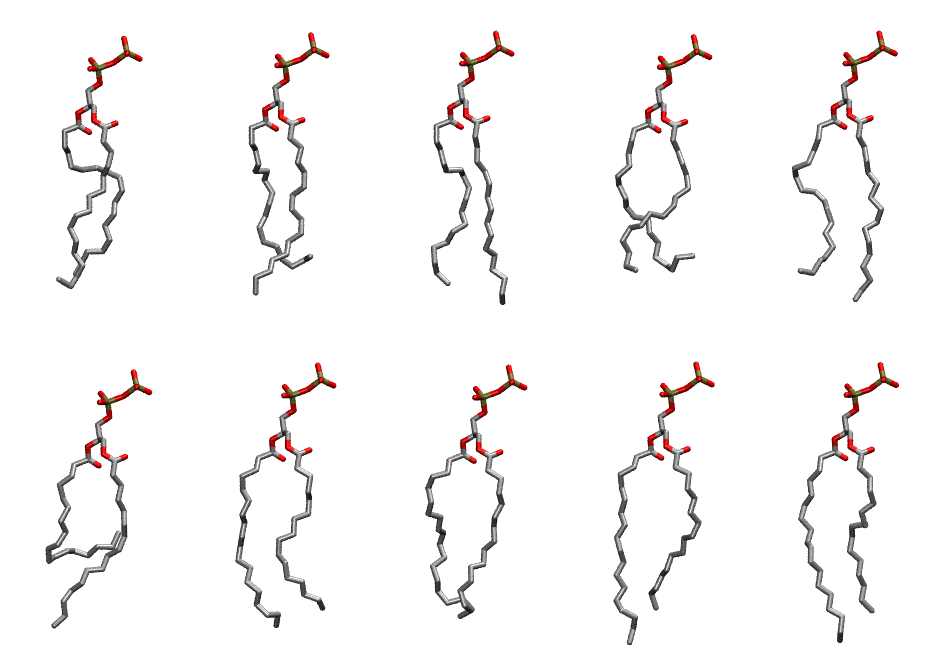

.. _lipid_gallery popp2:

POPP2
=====

**2,3-dioleoyl-D-glycero-1-pyrophosphate**

==============  ========================================
CHARMM resname  ``POPP2``
Net charge      -2.00
Atoms           120
Topology file   ``toppar_all36_lipid_miscellaneous.str``
Conformers      10 fluid
==============  ========================================

Structure
---------

Conformers
----------

The grid packer draws a conformer per lipid from this ensemble, so what the ensemble contains is what a built bilayer is made of. A leaflet declared ``phase: Lo`` generates an ordered ensemble when a build first needs it. All conformers are rendered at one shared scale.

============  =============  ================  ================
Conformer     Head-tail (Å)  Max internal (Å)  Min chain extent
============  =============  ================  ================
``POPP2-00``  14.07          26.29             0.68
``POPP2-01``  12.70          26.84             0.62
``POPP2-02``  15.52          27.80             0.75
``POPP2-03``  12.46          25.17             0.61
``POPP2-04``  14.30          27.47             0.69
``POPP2-05``  6.73           27.30             0.34
``POPP2-06``  14.81          27.43             0.79
``POPP2-07``  14.74          26.16             0.71
``POPP2-08``  14.89          29.22             0.81
``POPP2-09``  15.13          28.75             0.82
============  =============  ================  ================

*Min chain extent* is how far the least-extended acyl chain descends below its own attachment carbon, as a fraction of that chain's all-trans contour; an all-trans chain scores 1.0, and a conformer under 0.25 is rejected at generation as folded.

Provenance
----------

How the ensemble was generated, read from the entry's own ``info.yaml``:

===================  ============
Setting              ``POPP2``
===================  ============
Sampler              ``mc``
Phase                none (fluid)
Trans bias           0.0
Chain order          0.215
MC seed              0
Chains               2
Cylinder APL         60.0 Ų
Cylinder inflation   1.9
Equilibration steps  20000
Decorrelation steps  3000
Max MC angle         30°
Radius scale         0.8
Axial bias           1.0
===================  ============
