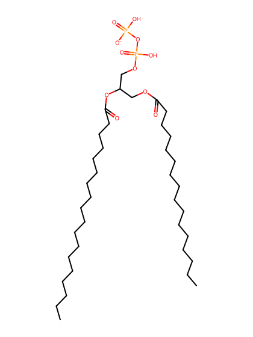
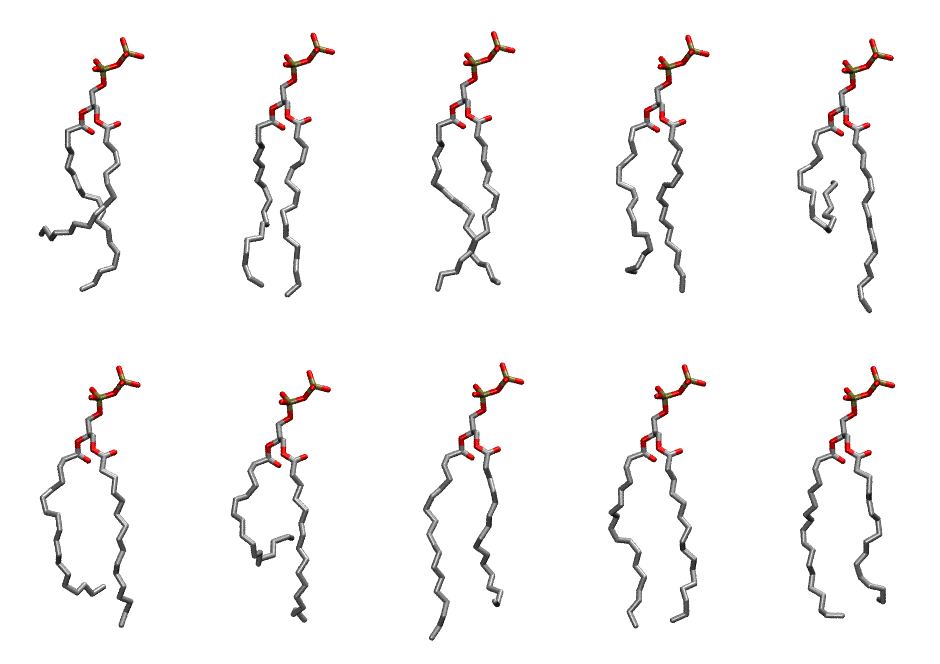

.. _lipid_gallery popp3:

POPP3
=====

**3-palmitoyl-2-oleoyl-D-glycero-1-Pyrophsphate**

==============  ========================================
CHARMM resname  ``POPP3``
Net charge      -1.00
Atoms           121
Topology file   ``toppar_all36_lipid_miscellaneous.str``
Conformers      10 fluid
==============  ========================================

Structure
---------

Conformers
----------

The grid packer draws a conformer per lipid from this ensemble, so what the ensemble contains is what a built bilayer is made of. A leaflet declared ``phase: Lo`` generates an ordered ensemble when a build first needs it. All conformers are rendered at one shared scale.

============  =============  ================  ================
Conformer     Head-tail (Å)  Max internal (Å)  Min chain extent
============  =============  ================  ================
``POPP3-00``  10.25          26.56             0.56
``POPP3-01``  15.82          27.18             0.76
``POPP3-02``  15.74          26.82             0.76
``POPP3-03``  14.28          26.24             0.69
``POPP3-04``  4.97           27.97             0.26
``POPP3-05``  12.71          26.81             0.62
``POPP3-06``  7.33           26.07             0.37
``POPP3-07``  14.48          29.08             0.78
``POPP3-08``  16.20          27.71             0.81
``POPP3-09``  13.93          26.39             0.75
============  =============  ================  ================

*Min chain extent* is how far the least-extended acyl chain descends below its own attachment carbon, as a fraction of that chain's all-trans contour; an all-trans chain scores 1.0, and a conformer under 0.25 is rejected at generation as folded.

Provenance
----------

How the ensemble was generated, read from the entry's own ``info.yaml``:

===================  ============
Setting              ``POPP3``
===================  ============
Sampler              ``mc``
Phase                none (fluid)
Trans bias           0.0
Chain order          0.218
MC seed              0
Chains               2
Cylinder APL         60.0 Ų
Cylinder inflation   1.9
Equilibration steps  20000
Decorrelation steps  3000
Max MC angle         30°
Radius scale         0.8
Axial bias           1.0
===================  ============
