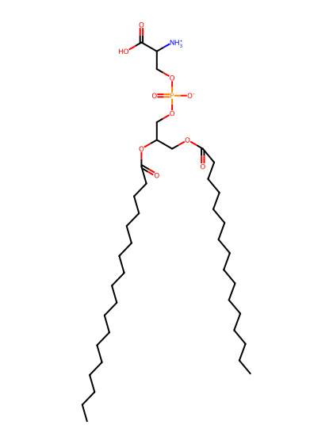
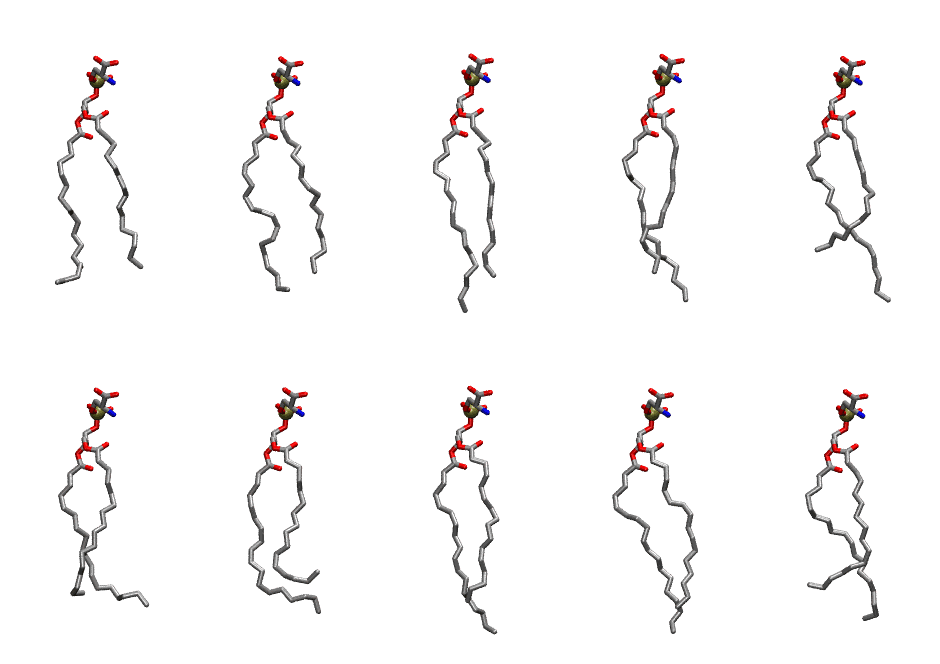

.. _lipid_gallery pops:

POPS
====

**3-palmitoyl-2-oleoyl-D-glycero-1-Phosphatidylserine**

==============  =======================
CHARMM resname  ``POPS``
Net charge      -1.00
Atoms           127
Topology file   ``top_all36_lipid.rtf``
Conformers      10 fluid
==============  =======================

Structure
---------

Conformers
----------

The grid packer draws a conformer per lipid from this ensemble, so what the ensemble contains is what a built bilayer is made of. A leaflet declared ``phase: Lo`` generates an ordered ensemble when a build first needs it. All conformers are rendered at one shared scale.

===========  =============  ================  ================
Conformer    Head-tail (Å)  Max internal (Å)  Min chain extent
===========  =============  ================  ================
``POPS-00``  13.88          25.12             0.74
``POPS-01``  14.34          26.13             0.77
``POPS-02``  15.04          28.33             0.89
``POPS-03``  14.63          27.34             0.83
``POPS-04``  12.06          27.58             0.74
``POPS-05``  13.31          24.60             0.69
``POPS-06``  11.09          24.84             0.69
``POPS-07``  14.28          27.80             0.83
``POPS-08``  14.72          26.85             0.82
``POPS-09``  12.25          25.90             0.75
===========  =============  ================  ================

*Min chain extent* is how far the least-extended acyl chain descends below its own attachment carbon, as a fraction of that chain's all-trans contour; an all-trans chain scores 1.0, and a conformer under 0.25 is rejected at generation as folded.

Provenance
----------

How the ensemble was generated, read from the entry's own ``info.yaml``:

===================  ============
Setting              ``POPS``
===================  ============
Sampler              ``mc``
Phase                none (fluid)
Trans bias           0.0
Chain order          0.230
MC seed              0
Chains               2
Cylinder APL         60.0 Ų
Cylinder inflation   1.9
Equilibration steps  20000
Decorrelation steps  3000
Max MC angle         30°
Radius scale         0.8
Axial bias           1.0
===================  ============
