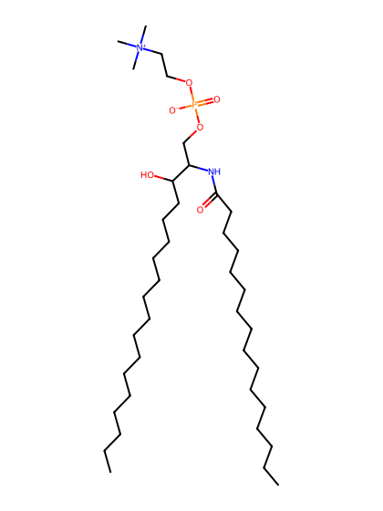
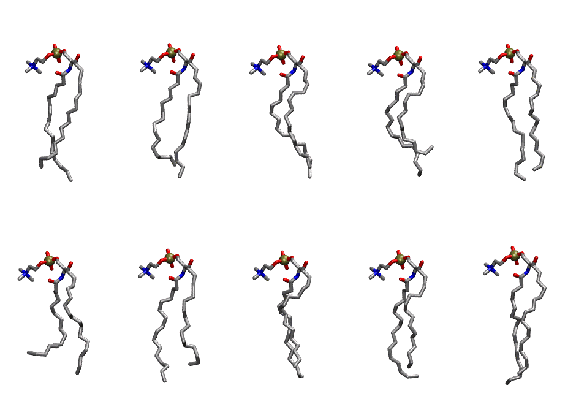
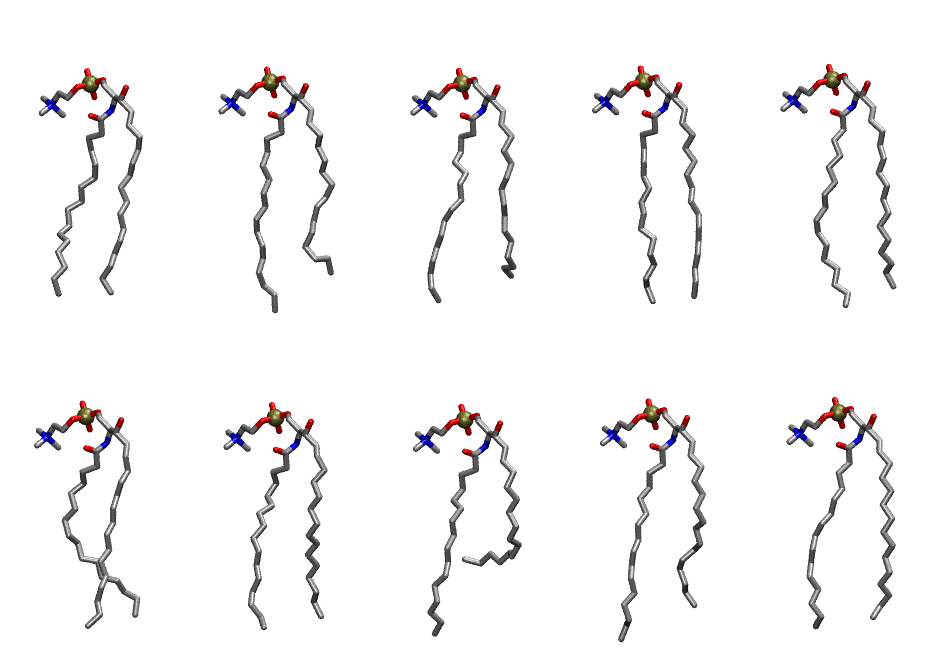

.. _lipid_gallery psm:

PSM
===

**sphingomyelin d18:1/16:0**

==============  =========================================
CHARMM resname  ``PSM``
Net charge      0.00
Atoms           127
Topology file   ``toppar_all36_lipid_sphingo.str``
Conformers      10 fluid, 10 liquid-ordered (``PSM__Lo``)
==============  =========================================

Structure
---------

Conformers
----------

The grid packer draws a conformer per lipid from an ensemble, so what the ensemble contains is what a built bilayer is made of. PSM ships two: a fluid one, used by default, and a liquid-ordered one, used for a leaflet declared ``phase: Lo``. All conformers on this page are rendered at one shared scale.

Fluid (``PSM``)
~~~~~~~~~~~~~~~

==========  =============  ================
Conformer   Head-tail (Å)  Max internal (Å)
==========  =============  ================
``PSM-00``  14.35          21.38
``PSM-01``  14.15          21.86
``PSM-02``  14.09          21.33
``PSM-03``  11.03          20.82
``PSM-04``  14.75          21.63
``PSM-05``  11.05          20.46
``PSM-06``  13.19          20.92
``PSM-07``  13.24          20.46
``PSM-08``  13.40          20.22
``PSM-09``  15.00          22.06
==========  =============  ================

Liquid-ordered (``PSM__Lo``)
~~~~~~~~~~~~~~~~~~~~~~~~~~~~

==========  =============  ================
Conformer   Head-tail (Å)  Max internal (Å)
==========  =============  ================
``PSM-00``  16.56          22.19
``PSM-01``  14.83          23.20
``PSM-02``  15.03          22.77
``PSM-03``  17.15          23.66
``PSM-04``  16.39          23.23
``PSM-05``  15.62          23.15
``PSM-06``  15.60          22.27
``PSM-07``  10.10          22.38
``PSM-08``  14.92          23.24
``PSM-09``  16.17          22.38
==========  =============  ================

Provenance
----------

How each ensemble was generated, read from the entry's own ``info.yaml``:

===================  ============  ===========
Setting              ``PSM``       ``PSM__Lo``
===================  ============  ===========
Sampler              ``mc``        ``mc``
Phase                none (fluid)  Lo
Trans bias           0.0           3.125
Chain order          0.220         0.316
MC seed              0             0
Chains               2             2
Cylinder APL         60.0 Ų       60.0 Ų
Cylinder inflation   1.9           1.9
Equilibration steps  20000         20000
Decorrelation steps  3000          3000
Max MC angle         30°           30°
Radius scale         0.8           0.8
Axial bias           1.0           1.0
===================  ============  ===========
