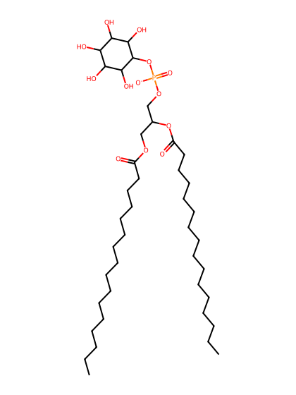
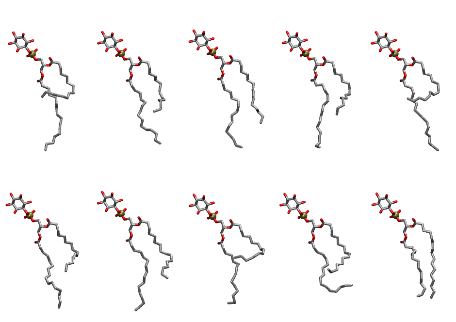

.. _lipid_gallery pypi:

PYPI
====

**1-palmitoyl-2-palmitoleoyl-sn-glycero-3-phosphoinositol**

==============  ===================================
CHARMM resname  ``PYPI``
Net charge      -1.00
Atoms           131
Topology file   ``toppar_all36_lipid_inositol.str``
Conformers      10 fluid
==============  ===================================

Structure
---------

Conformers
----------

The grid packer draws a conformer per lipid from this ensemble, so what the ensemble contains is what a built bilayer is made of. A leaflet declared ``phase: Lo`` generates an ordered ensemble when a build first needs it. All conformers are rendered at one shared scale.

===========  =============  ================  ================
Conformer    Head-tail (Å)  Max internal (Å)  Min chain extent
===========  =============  ================  ================
``PYPI-00``  3.53           28.61             0.41
``PYPI-01``  6.95           29.80             0.59
``PYPI-02``  9.82           29.89             0.74
``PYPI-03``  7.65           28.47             0.63
``PYPI-04``  4.04           31.05             0.44
``PYPI-05``  6.47           29.32             0.57
``PYPI-06``  8.39           28.77             0.67
``PYPI-07``  3.23           27.50             0.40
``PYPI-08``  6.08           27.01             0.51
``PYPI-09``  12.23          27.91             0.65
===========  =============  ================  ================

*Min chain extent* is how far the least-extended acyl chain descends below its own attachment carbon, as a fraction of that chain's all-trans contour; an all-trans chain scores 1.0, and a conformer under 0.25 is rejected at generation as folded.

Provenance
----------

How the ensemble was generated, read from the entry's own ``info.yaml``:

===================  ============
Setting              ``PYPI``
===================  ============
Sampler              ``mc``
Phase                none (fluid)
Trans bias           0.0
Chain order          0.138
MC seed              0
Chains               2
Cylinder APL         60.0 Ų
Cylinder inflation   1.9
Equilibration steps  20000
Decorrelation steps  3000
Max MC angle         30°
Radius scale         0.8
Axial bias           1.0
===================  ============
