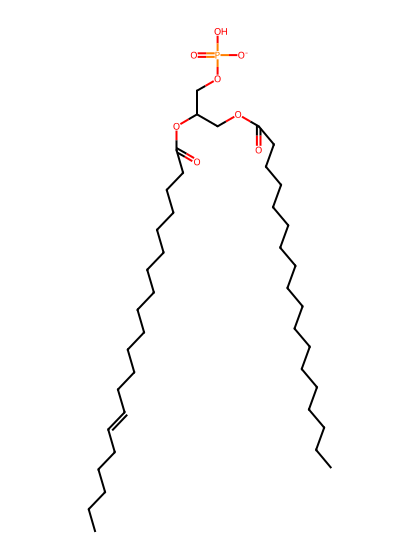
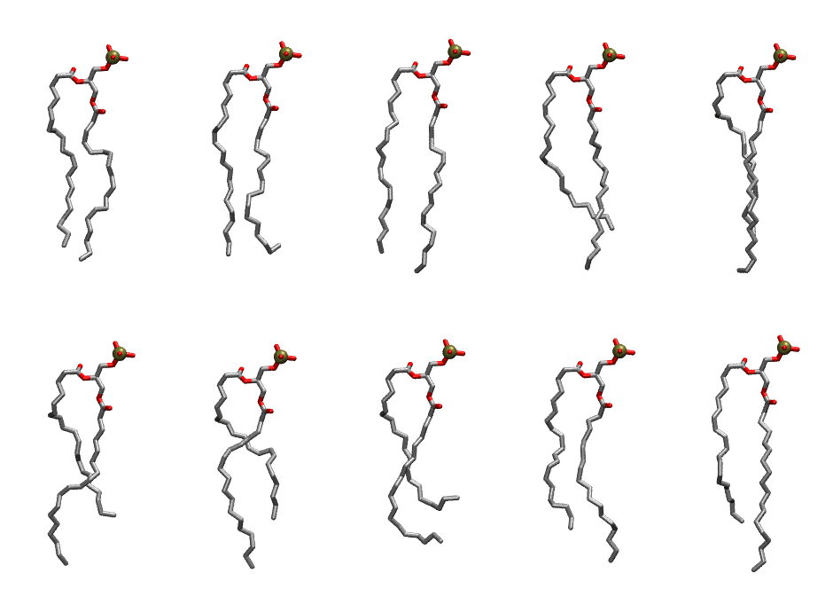

.. _lipid_gallery sapa:

SAPA
====

**1-Stearoyl-2-Arachidonyl-Phosphotidic acid**

==============  ========================================
CHARMM resname  ``SAPA``
Net charge      -1.00
Atoms           122
Topology file   ``toppar_all36_lipid_miscellaneous.str``
Conformers      10 fluid
==============  ========================================

Structure
---------

Conformers
----------

The grid packer draws a conformer per lipid from this ensemble, so what the ensemble contains is what a built bilayer is made of. A leaflet declared ``phase: Lo`` generates an ordered ensemble when a build first needs it. All conformers are rendered at one shared scale.

===========  =============  ================  ================
Conformer    Head-tail (Å)  Max internal (Å)  Min chain extent
===========  =============  ================  ================
``SAPA-00``  15.40          25.98             0.79
``SAPA-01``  15.81          26.09             0.73
``SAPA-02``  16.73          27.85             0.87
``SAPA-03``  13.66          26.81             0.74
``SAPA-04``  14.39          27.36             0.77
``SAPA-05``  12.31          26.89             0.68
``SAPA-06``  12.27          26.34             0.68
``SAPA-07``  10.54          24.12             0.61
``SAPA-08``  14.07          26.14             0.76
``SAPA-09``  13.69          28.04             0.74
===========  =============  ================  ================

*Min chain extent* is how far the least-extended acyl chain descends below its own attachment carbon, as a fraction of that chain's all-trans contour; an all-trans chain scores 1.0, and a conformer under 0.25 is rejected at generation as folded.

Provenance
----------

How the ensemble was generated, read from the entry's own ``info.yaml``:

===================  ============
Setting              ``SAPA``
===================  ============
Sampler              ``mc``
Phase                none (fluid)
Trans bias           0.0
Chain order          0.226
MC seed              0
Chains               2
Cylinder APL         60.0 Ų
Cylinder inflation   1.9
Equilibration steps  20000
Decorrelation steps  3000
Max MC angle         30°
Radius scale         0.8
Axial bias           1.0
===================  ============
