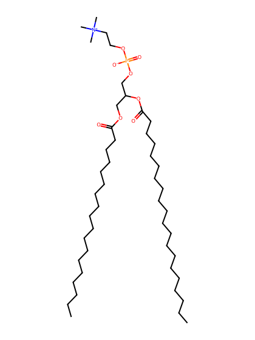
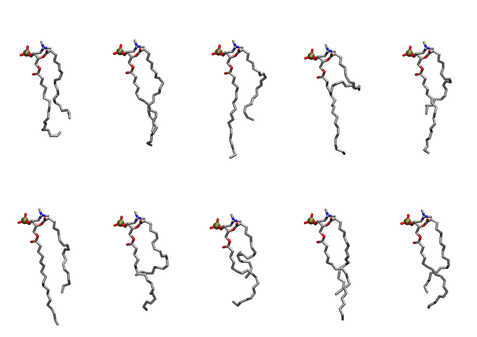

.. _lipid_gallery sapc:

SAPC
====

**3-stearoyl-2-arachidonyl-D-glycero-1-phosphatidylcholine**

==============  =======================
CHARMM resname  ``SAPC``
Net charge      0.00
Atoms           140
Topology file   ``top_all36_lipid.rtf``
Conformers      10 fluid
==============  =======================

Structure
---------

Conformers
----------

The grid packer draws a conformer per lipid from this ensemble, so what the ensemble contains is what a built bilayer is made of. A leaflet declared ``phase: Lo`` generates an ordered ensemble when a build first needs it. All conformers are rendered at one shared scale.

===========  =============  ================  ================
Conformer    Head-tail (Å)  Max internal (Å)  Min chain extent
===========  =============  ================  ================
``SAPC-00``  10.09          25.76             0.62
``SAPC-01``  13.48          27.46             0.76
``SAPC-02``  10.66          29.16             0.65
``SAPC-03``  3.45           28.06             0.35
``SAPC-04``  8.98           27.82             0.58
``SAPC-05``  11.57          30.47             0.69
``SAPC-06``  7.03           27.98             0.50
``SAPC-07``  6.96           23.77             0.49
``SAPC-08``  11.99          27.71             0.70
``SAPC-09``  11.30          26.64             0.67
===========  =============  ================  ================

*Min chain extent* is how far the least-extended acyl chain descends below its own attachment carbon, as a fraction of that chain's all-trans contour; an all-trans chain scores 1.0, and a conformer under 0.25 is rejected at generation as folded.

Provenance
----------

How the ensemble was generated, read from the entry's own ``info.yaml``:

===================  ============
Setting              ``SAPC``
===================  ============
Sampler              ``mc``
Phase                none (fluid)
Trans bias           0.0
Chain order          0.167
MC seed              0
Chains               2
Cylinder APL         60.0 Ų
Cylinder inflation   1.9
Equilibration steps  20000
Decorrelation steps  3000
Max MC angle         30°
Radius scale         0.8
Axial bias           1.0
===================  ============
