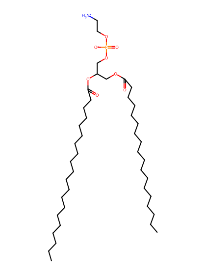
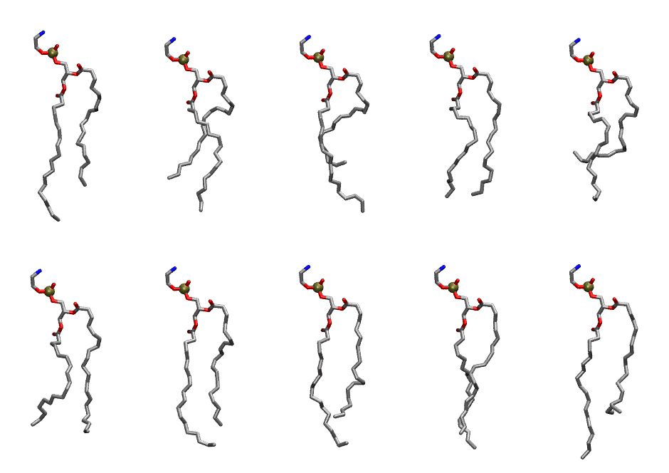

.. _lipid_gallery sape:

SAPE
====

**1-Stearoyl-2-Arachidonyl-Phosphatidylethanolamine**

==============  ========================================
CHARMM resname  ``SAPE``
Net charge      0.00
Atoms           131
Topology file   ``toppar_all36_lipid_miscellaneous.str``
Conformers      10 fluid
==============  ========================================

Structure
---------

Conformers
----------

The grid packer draws a conformer per lipid from this ensemble, so what the ensemble contains is what a built bilayer is made of. A leaflet declared ``phase: Lo`` generates an ordered ensemble when a build first needs it. All conformers are rendered at one shared scale.

===========  =============  ================  ================
Conformer    Head-tail (Å)  Max internal (Å)  Min chain extent
===========  =============  ================  ================
``SAPE-00``  13.45          30.28             0.72
``SAPE-01``  11.38          28.33             0.63
``SAPE-02``  9.34           29.13             0.55
``SAPE-03``  14.30          26.65             0.68
``SAPE-04``  7.46           26.42             0.47
``SAPE-05``  13.64          27.18             0.63
``SAPE-06``  14.00          29.28             0.74
``SAPE-07``  13.03          29.16             0.70
``SAPE-08``  15.49          29.36             0.80
``SAPE-09``  12.40          30.67             0.68
===========  =============  ================  ================

*Min chain extent* is how far the least-extended acyl chain descends below its own attachment carbon, as a fraction of that chain's all-trans contour; an all-trans chain scores 1.0, and a conformer under 0.25 is rejected at generation as folded.

Provenance
----------

How the ensemble was generated, read from the entry's own ``info.yaml``:

===================  ============
Setting              ``SAPE``
===================  ============
Sampler              ``mc``
Phase                none (fluid)
Trans bias           0.0
Chain order          0.191
MC seed              0
Chains               2
Cylinder APL         60.0 Ų
Cylinder inflation   1.9
Equilibration steps  20000
Decorrelation steps  3000
Max MC angle         30°
Radius scale         0.8
Axial bias           1.0
===================  ============
