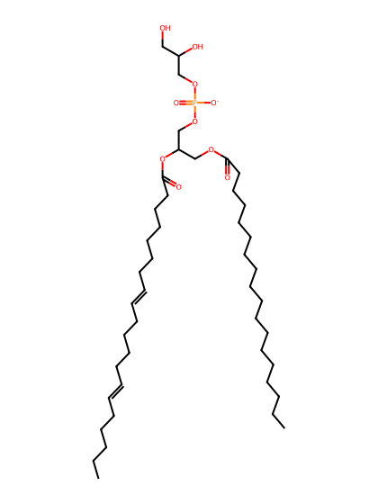
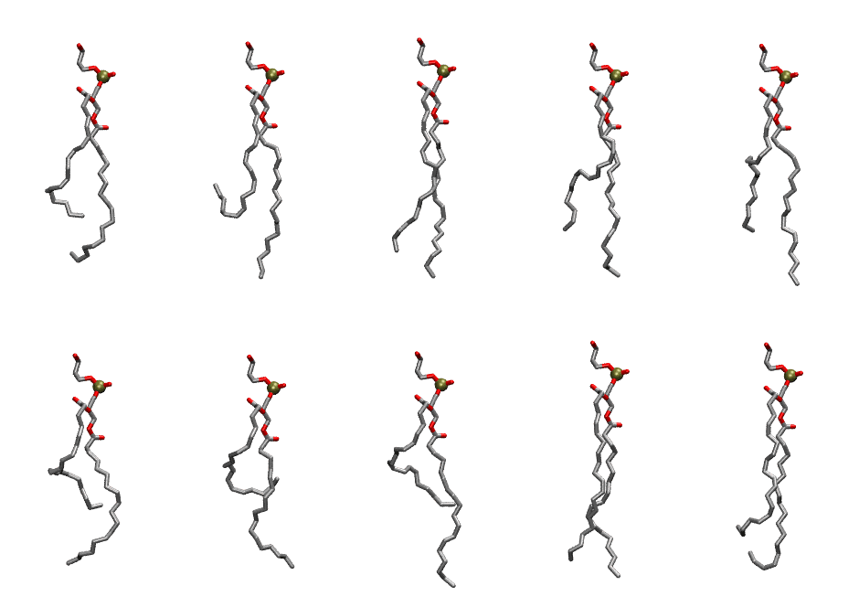

.. _lipid_gallery sapg:

SAPG
====

**1-Stearoyl-2-Arachidonyl-Phosphatidylglycerol**

==============  ========================================
CHARMM resname  ``SAPG``
Net charge      -1.00
Atoms           133
Topology file   ``toppar_all36_lipid_miscellaneous.str``
Conformers      10 fluid
==============  ========================================

Structure
---------

Conformers
----------

The grid packer draws a conformer per lipid from this ensemble, so what the ensemble contains is what a built bilayer is made of. A leaflet declared ``phase: Lo`` generates an ordered ensemble when a build first needs it. All conformers are rendered at one shared scale.

===========  =============  ================  ================
Conformer    Head-tail (Å)  Max internal (Å)  Min chain extent
===========  =============  ================  ================
``SAPG-00``  10.82          27.44             0.62
``SAPG-01``  7.31           29.80             0.47
``SAPG-02``  15.76          30.52             0.82
``SAPG-03``  12.55          29.48             0.69
``SAPG-04``  12.57          30.60             0.69
``SAPG-05``  8.29           26.80             0.51
``SAPG-06``  4.93           27.11             0.37
``SAPG-07``  8.44           30.10             0.52
``SAPG-08``  16.49          29.82             0.85
``SAPG-09``  12.33          28.56             0.68
===========  =============  ================  ================

*Min chain extent* is how far the least-extended acyl chain descends below its own attachment carbon, as a fraction of that chain's all-trans contour; an all-trans chain scores 1.0, and a conformer under 0.25 is rejected at generation as folded.

Provenance
----------

How the ensemble was generated, read from the entry's own ``info.yaml``:

===================  ============
Setting              ``SAPG``
===================  ============
Sampler              ``mc``
Phase                none (fluid)
Trans bias           0.0
Chain order          0.198
MC seed              0
Chains               2
Cylinder APL         60.0 Ų
Cylinder inflation   1.9
Equilibration steps  20000
Decorrelation steps  3000
Max MC angle         30°
Radius scale         0.8
Axial bias           1.0
===================  ============
