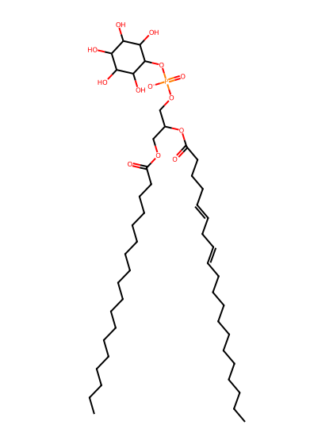
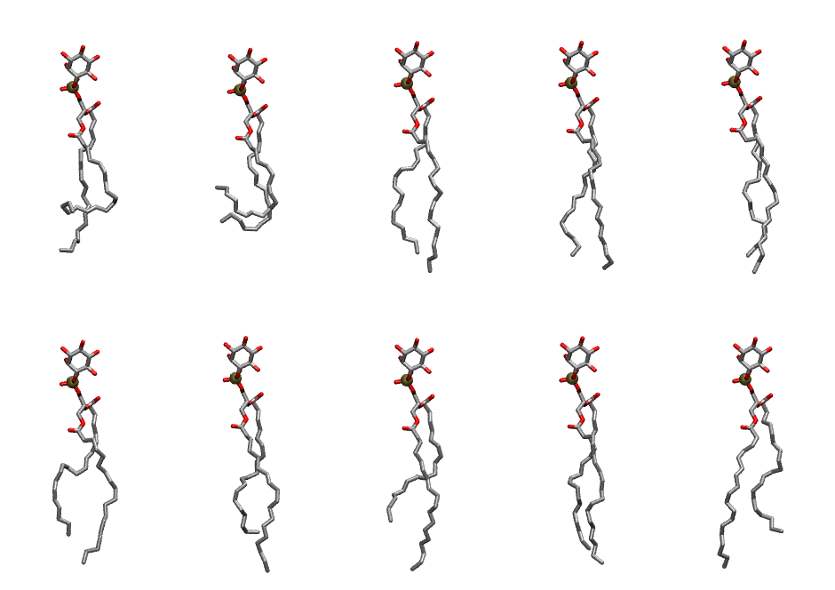

.. _lipid_gallery sapi:

SAPI
====

**Phosphatidylinositol**

==============  ===================================
CHARMM resname  ``SAPI``
Net charge      -1.00
Atoms           143
Topology file   ``toppar_all36_lipid_inositol.str``
Conformers      10 fluid
==============  ===================================

Structure
---------

Conformers
----------

The grid packer draws a conformer per lipid from this ensemble, so what the ensemble contains is what a built bilayer is made of. A leaflet declared ``phase: Lo`` generates an ordered ensemble when a build first needs it. All conformers are rendered at one shared scale.

===========  =============  ================  ================
Conformer    Head-tail (Å)  Max internal (Å)  Min chain extent
===========  =============  ================  ================
``SAPI-00``  10.11          29.47             0.46
``SAPI-01``  6.58           26.70             0.30
``SAPI-02``  16.06          31.89             0.81
``SAPI-03``  16.46          31.82             0.83
``SAPI-04``  16.65          32.12             0.84
``SAPI-05``  13.84          30.92             0.72
``SAPI-06``  14.06          32.83             0.73
``SAPI-07``  12.25          32.34             0.65
``SAPI-08``  16.18          31.87             0.82
``SAPI-09``  13.80          32.55             0.72
===========  =============  ================  ================

*Min chain extent* is how far the least-extended acyl chain descends below its own attachment carbon, as a fraction of that chain's all-trans contour; an all-trans chain scores 1.0, and a conformer under 0.25 is rejected at generation as folded.

Provenance
----------

How the ensemble was generated, read from the entry's own ``info.yaml``:

===================  ============
Setting              ``SAPI``
===================  ============
Sampler              ``mc``
Phase                none (fluid)
Trans bias           0.0
Chain order          0.218
MC seed              0
Chains               2
Cylinder APL         60.0 Ų
Cylinder inflation   1.9
Equilibration steps  20000
Decorrelation steps  3000
Max MC angle         30°
Radius scale         0.8
Axial bias           1.0
===================  ============
