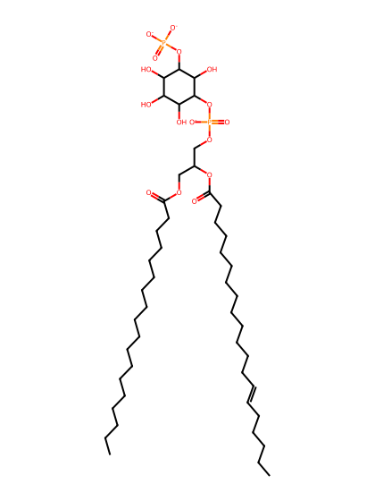
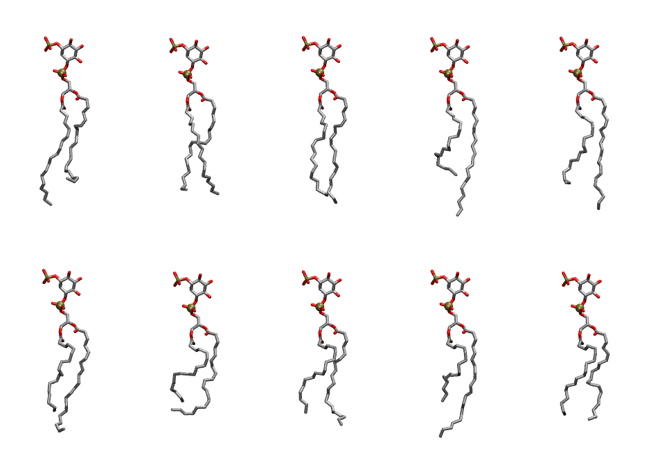

.. _lipid_gallery sapi13:

SAPI13
======

**Phosphatidylinositol-(3)-phosphate (PIP1)**

==============  ===================================
CHARMM resname  ``SAPI13``
Net charge      -3.00
Atoms           146
Topology file   ``toppar_all36_lipid_inositol.str``
Conformers      10 fluid
==============  ===================================

Structure
---------

Conformers
----------

The grid packer draws a conformer per lipid from this ensemble, so what the ensemble contains is what a built bilayer is made of. A leaflet declared ``phase: Lo`` generates an ordered ensemble when a build first needs it. All conformers are rendered at one shared scale.

=============  =============  ================  ================
Conformer      Head-tail (Å)  Max internal (Å)  Min chain extent
=============  =============  ================  ================
``SAPI13-00``  13.12          33.20             0.63
``SAPI13-01``  14.90          31.03             0.70
``SAPI13-02``  16.30          32.78             0.77
``SAPI13-03``  12.31          34.58             0.59
``SAPI13-04``  13.82          33.36             0.66
``SAPI13-05``  13.04          31.52             0.62
``SAPI13-06``  10.74          28.14             0.52
``SAPI13-07``  13.08          30.49             0.63
``SAPI13-08``  11.04          32.50             0.53
``SAPI13-09``  13.21          28.96             0.63
=============  =============  ================  ================

*Min chain extent* is how far the least-extended acyl chain descends below its own attachment carbon, as a fraction of that chain's all-trans contour; an all-trans chain scores 1.0, and a conformer under 0.25 is rejected at generation as folded.

Provenance
----------

How the ensemble was generated, read from the entry's own ``info.yaml``:

===================  ============
Setting              ``SAPI13``
===================  ============
Sampler              ``mc``
Phase                none (fluid)
Trans bias           0.0
Chain order          0.144
MC seed              0
Chains               2
Cylinder APL         60.0 Ų
Cylinder inflation   1.9
Equilibration steps  20000
Decorrelation steps  3000
Max MC angle         30°
Radius scale         0.8
Axial bias           1.0
===================  ============
