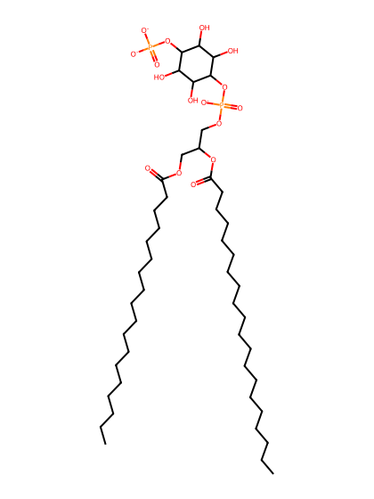
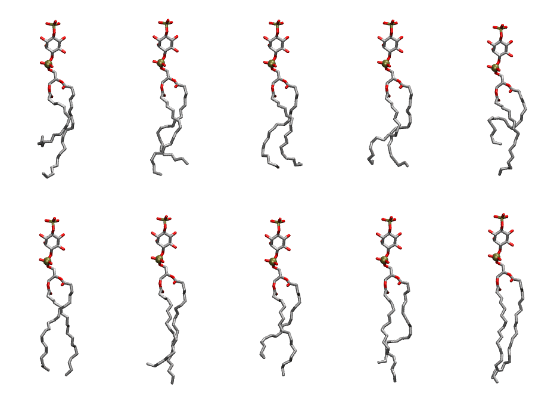

.. _lipid_gallery sapi14:

SAPI14
======

**Phosphatidylinositol-(4)-phosphate (PIP1)**

==============  ===================================
CHARMM resname  ``SAPI14``
Net charge      -3.00
Atoms           146
Topology file   ``toppar_all36_lipid_inositol.str``
Conformers      10 fluid
==============  ===================================

Structure
---------

Conformers
----------

The grid packer draws a conformer per lipid from this ensemble, so what the ensemble contains is what a built bilayer is made of. A leaflet declared ``phase: Lo`` generates an ordered ensemble when a build first needs it. All conformers are rendered at one shared scale.

=============  =============  ================  ================
Conformer      Head-tail (Å)  Max internal (Å)  Min chain extent
=============  =============  ================  ================
``SAPI14-00``  8.10           33.04             0.39
``SAPI14-01``  13.86          32.45             0.67
``SAPI14-02``  13.66          30.94             0.65
``SAPI14-03``  13.18          30.75             0.63
``SAPI14-04``  8.82           31.42             0.46
``SAPI14-05``  15.53          33.14             0.73
``SAPI14-06``  14.66          34.80             0.70
``SAPI14-07``  12.89          32.35             0.63
``SAPI14-08``  14.17          34.25             0.68
``SAPI14-09``  17.89          35.06             0.83
=============  =============  ================  ================

*Min chain extent* is how far the least-extended acyl chain descends below its own attachment carbon, as a fraction of that chain's all-trans contour; an all-trans chain scores 1.0, and a conformer under 0.25 is rejected at generation as folded.

Provenance
----------

How the ensemble was generated, read from the entry's own ``info.yaml``:

===================  ============
Setting              ``SAPI14``
===================  ============
Sampler              ``mc``
Phase                none (fluid)
Trans bias           0.0
Chain order          0.175
MC seed              0
Chains               2
Cylinder APL         60.0 Ų
Cylinder inflation   1.9
Equilibration steps  20000
Decorrelation steps  3000
Max MC angle         30°
Radius scale         0.8
Axial bias           1.0
===================  ============
