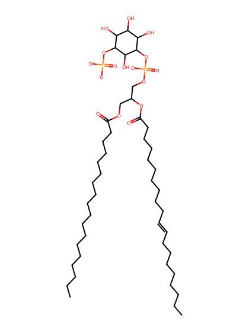
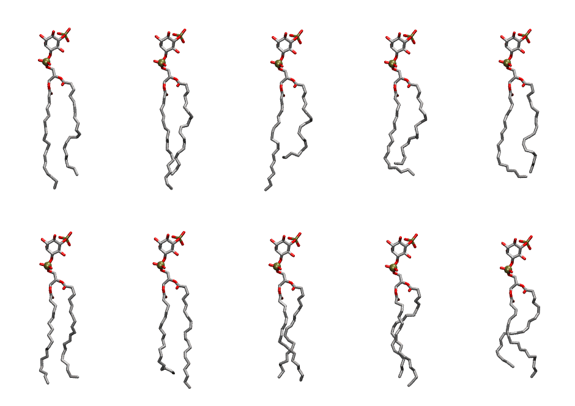

.. _lipid_gallery sapi15:

SAPI15
======

**Phosphatidylinositol-(5)-phosphate (PIP1)**

==============  ===================================
CHARMM resname  ``SAPI15``
Net charge      -3.00
Atoms           146
Topology file   ``toppar_all36_lipid_inositol.str``
Conformers      10 fluid
==============  ===================================

Structure
---------

Conformers
----------

The grid packer draws a conformer per lipid from this ensemble, so what the ensemble contains is what a built bilayer is made of. A leaflet declared ``phase: Lo`` generates an ordered ensemble when a build first needs it. All conformers are rendered at one shared scale.

=============  =============  ================  ================
Conformer      Head-tail (Å)  Max internal (Å)  Min chain extent
=============  =============  ================  ================
``SAPI15-00``  16.69          33.79             0.79
``SAPI15-01``  16.40          33.98             0.78
``SAPI15-02``  12.73          34.44             0.62
``SAPI15-03``  13.96          30.88             0.68
``SAPI15-04``  15.91          31.58             0.76
``SAPI15-05``  16.39          32.27             0.78
``SAPI15-06``  15.69          33.44             0.74
``SAPI15-07``  16.23          31.79             0.77
``SAPI15-08``  15.90          32.20             0.76
``SAPI15-09``  13.45          30.39             0.65
=============  =============  ================  ================

*Min chain extent* is how far the least-extended acyl chain descends below its own attachment carbon, as a fraction of that chain's all-trans contour; an all-trans chain scores 1.0, and a conformer under 0.25 is rejected at generation as folded.

Provenance
----------

How the ensemble was generated, read from the entry's own ``info.yaml``:

===================  ============
Setting              ``SAPI15``
===================  ============
Sampler              ``mc``
Phase                none (fluid)
Trans bias           0.0
Chain order          0.226
MC seed              0
Chains               2
Cylinder APL         60.0 Ų
Cylinder inflation   1.9
Equilibration steps  20000
Decorrelation steps  3000
Max MC angle         30°
Radius scale         0.8
Axial bias           1.0
===================  ============
