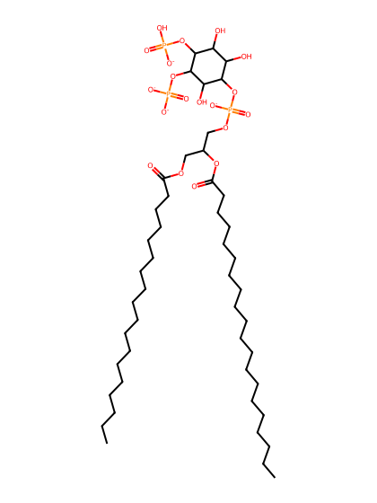
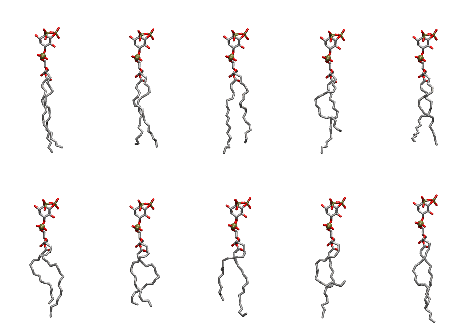

.. _lipid_gallery sapi24:

SAPI24
======

**Phosphatidylinositol-(4,5)-bisphosphate (PIP2) with protonation on P4**

==============  ===================================
CHARMM resname  ``SAPI24``
Net charge      -4.00
Atoms           150
Topology file   ``toppar_all36_lipid_inositol.str``
Conformers      10 fluid
==============  ===================================

Structure
---------

Conformers
----------

The grid packer draws a conformer per lipid from this ensemble, so what the ensemble contains is what a built bilayer is made of. A leaflet declared ``phase: Lo`` generates an ordered ensemble when a build first needs it. All conformers are rendered at one shared scale.

=============  =============  ================  ================
Conformer      Head-tail (Å)  Max internal (Å)  Min chain extent
=============  =============  ================  ================
``SAPI24-00``  17.45          33.56             0.82
``SAPI24-01``  16.27          30.95             0.76
``SAPI24-02``  15.82          32.95             0.73
``SAPI24-03``  12.62          32.85             0.60
``SAPI24-04``  15.39          30.71             0.72
``SAPI24-05``  13.64          31.67             0.64
``SAPI24-06``  13.79          28.78             0.65
``SAPI24-07``  12.96          31.45             0.61
``SAPI24-08``  8.20           31.90             0.42
``SAPI24-09``  15.62          34.16             0.72
=============  =============  ================  ================

*Min chain extent* is how far the least-extended acyl chain descends below its own attachment carbon, as a fraction of that chain's all-trans contour; an all-trans chain scores 1.0, and a conformer under 0.25 is rejected at generation as folded.

Provenance
----------

How the ensemble was generated, read from the entry's own ``info.yaml``:

===================  ============
Setting              ``SAPI24``
===================  ============
Sampler              ``mc``
Phase                none (fluid)
Trans bias           0.0
Chain order          0.204
MC seed              0
Chains               2
Cylinder APL         60.0 Ų
Cylinder inflation   1.9
Equilibration steps  20000
Decorrelation steps  3000
Max MC angle         30°
Radius scale         0.8
Axial bias           1.0
===================  ============
