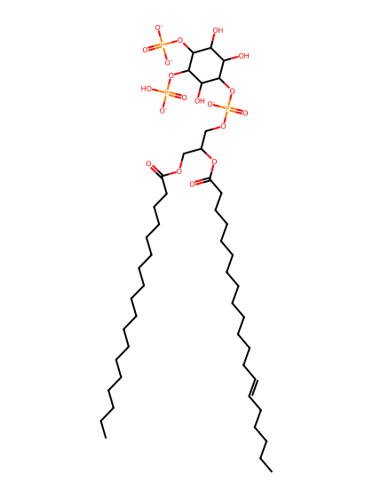
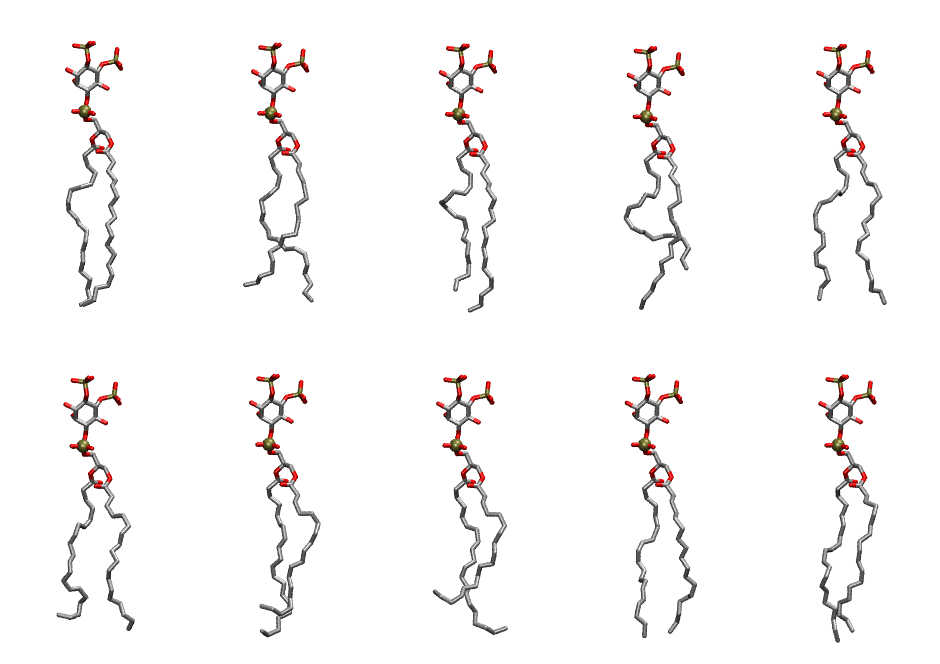

.. _lipid_gallery sapi25:

SAPI25
======

**Phosphatidylinositol-(4,5)-bisphosphate (PIP2) with protonation on P5**

==============  ===================================
CHARMM resname  ``SAPI25``
Net charge      -4.00
Atoms           150
Topology file   ``toppar_all36_lipid_inositol.str``
Conformers      10 fluid
==============  ===================================

Structure
---------

Conformers
----------

The grid packer draws a conformer per lipid from this ensemble, so what the ensemble contains is what a built bilayer is made of. A leaflet declared ``phase: Lo`` generates an ordered ensemble when a build first needs it. All conformers are rendered at one shared scale.

=============  =============  ================  ================
Conformer      Head-tail (Å)  Max internal (Å)  Min chain extent
=============  =============  ================  ================
``SAPI25-00``  18.88          33.56             0.80
``SAPI25-01``  16.24          32.68             0.75
``SAPI25-02``  16.66          33.59             0.71
``SAPI25-03``  13.73          32.92             0.59
``SAPI25-04``  17.78          32.72             0.76
``SAPI25-05``  15.86          32.12             0.68
``SAPI25-06``  15.01          33.41             0.69
``SAPI25-07``  13.11          33.26             0.60
``SAPI25-08``  18.11          32.98             0.79
``SAPI25-09``  17.91          33.71             0.81
=============  =============  ================  ================

*Min chain extent* is how far the least-extended acyl chain descends below its own attachment carbon, as a fraction of that chain's all-trans contour; an all-trans chain scores 1.0, and a conformer under 0.25 is rejected at generation as folded.

Provenance
----------

How the ensemble was generated, read from the entry's own ``info.yaml``:

===================  ============
Setting              ``SAPI25``
===================  ============
Sampler              ``mc``
Phase                none (fluid)
Trans bias           0.0
Chain order          0.208
MC seed              0
Chains               2
Cylinder APL         60.0 Ų
Cylinder inflation   1.9
Equilibration steps  20000
Decorrelation steps  3000
Max MC angle         30°
Radius scale         0.8
Axial bias           1.0
===================  ============
