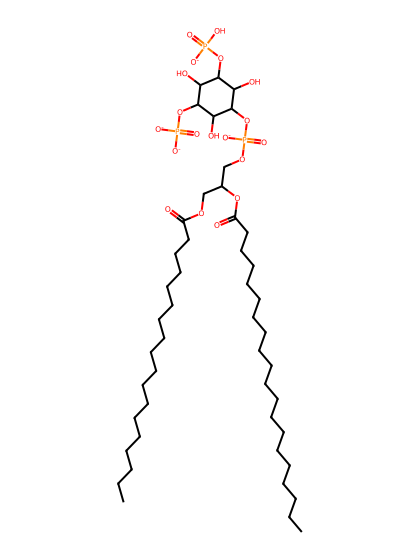
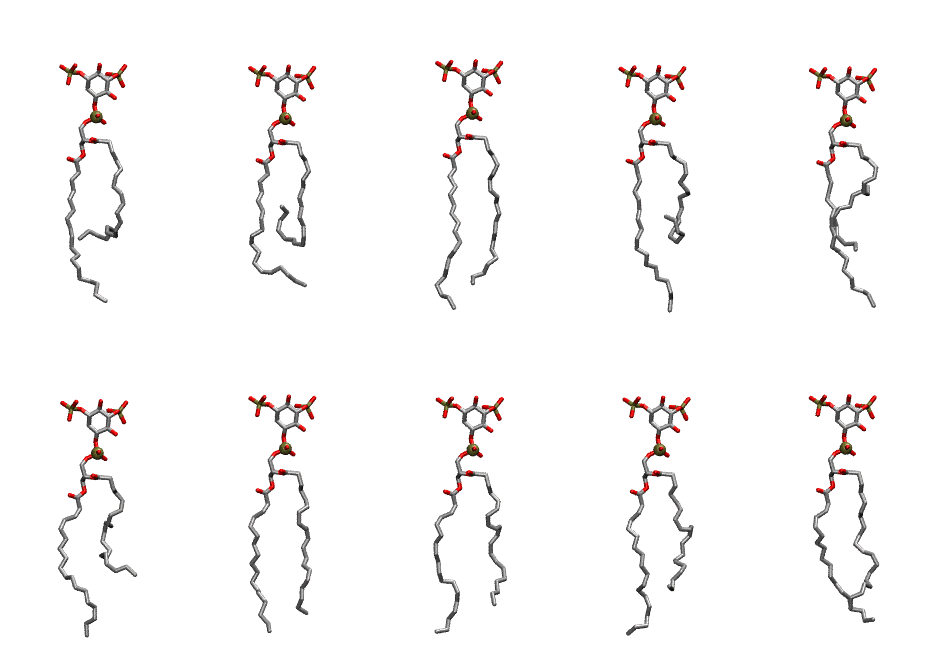

.. _lipid_gallery sapi2a:

SAPI2A
======

**Phosphatidylinositol-(3,5)-bisphosphate (PIP2) with protonation on P3**

==============  ===================================
CHARMM resname  ``SAPI2A``
Net charge      -4.00
Atoms           150
Topology file   ``toppar_all36_lipid_inositol.str``
Conformers      10 fluid
==============  ===================================

Structure
---------

Conformers
----------

The grid packer draws a conformer per lipid from this ensemble, so what the ensemble contains is what a built bilayer is made of. A leaflet declared ``phase: Lo`` generates an ordered ensemble when a build first needs it. All conformers are rendered at one shared scale.

=============  =============  ================  ================
Conformer      Head-tail (Å)  Max internal (Å)  Min chain extent
=============  =============  ================  ================
``SAPI2A-00``  10.38          32.90             0.53
``SAPI2A-01``  6.03           30.45             0.35
``SAPI2A-02``  16.65          34.02             0.79
``SAPI2A-03``  7.26           33.81             0.40
``SAPI2A-04``  11.31          32.89             0.57
``SAPI2A-05``  10.36          31.80             0.53
``SAPI2A-06``  15.94          32.28             0.76
``SAPI2A-07``  14.61          32.70             0.70
``SAPI2A-08``  12.32          32.78             0.61
``SAPI2A-09``  15.38          31.68             0.73
=============  =============  ================  ================

*Min chain extent* is how far the least-extended acyl chain descends below its own attachment carbon, as a fraction of that chain's all-trans contour; an all-trans chain scores 1.0, and a conformer under 0.25 is rejected at generation as folded.

Provenance
----------

How the ensemble was generated, read from the entry's own ``info.yaml``:

===================  ============
Setting              ``SAPI2A``
===================  ============
Sampler              ``mc``
Phase                none (fluid)
Trans bias           0.0
Chain order          0.215
MC seed              0
Chains               2
Cylinder APL         60.0 Ų
Cylinder inflation   1.9
Equilibration steps  20000
Decorrelation steps  3000
Max MC angle         30°
Radius scale         0.8
Axial bias           1.0
===================  ============
