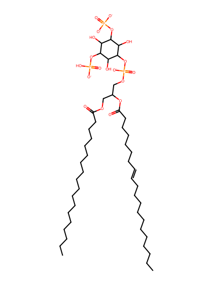
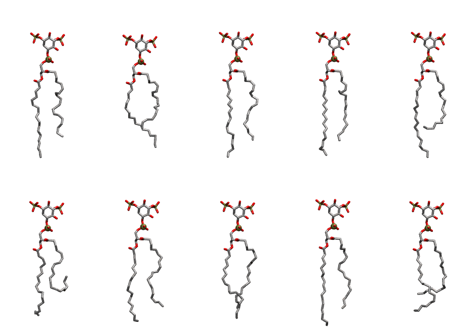

.. _lipid_gallery sapi2b:

SAPI2B
======

**Phosphatidylinositol-(3,5)-bisphosphate (PIP2) with protonation on P5**

==============  ===================================
CHARMM resname  ``SAPI2B``
Net charge      -4.00
Atoms           150
Topology file   ``toppar_all36_lipid_inositol.str``
Conformers      10 fluid
==============  ===================================

Structure
---------

Conformers
----------

The grid packer draws a conformer per lipid from this ensemble, so what the ensemble contains is what a built bilayer is made of. A leaflet declared ``phase: Lo`` generates an ordered ensemble when a build first needs it. All conformers are rendered at one shared scale.

=============  =============  ================  ================
Conformer      Head-tail (Å)  Max internal (Å)  Min chain extent
=============  =============  ================  ================
``SAPI2B-00``  14.40          33.48             0.69
``SAPI2B-01``  11.68          31.03             0.58
``SAPI2B-02``  15.39          33.72             0.74
``SAPI2B-03``  15.62          33.47             0.75
``SAPI2B-04``  12.13          33.96             0.60
``SAPI2B-05``  7.08           31.55             0.39
``SAPI2B-06``  15.06          33.07             0.72
``SAPI2B-07``  15.19          32.02             0.73
``SAPI2B-08``  15.64          34.04             0.75
``SAPI2B-09``  11.53          30.15             0.58
=============  =============  ================  ================

*Min chain extent* is how far the least-extended acyl chain descends below its own attachment carbon, as a fraction of that chain's all-trans contour; an all-trans chain scores 1.0, and a conformer under 0.25 is rejected at generation as folded.

Provenance
----------

How the ensemble was generated, read from the entry's own ``info.yaml``:

===================  ============
Setting              ``SAPI2B``
===================  ============
Sampler              ``mc``
Phase                none (fluid)
Trans bias           0.0
Chain order          0.220
MC seed              0
Chains               2
Cylinder APL         60.0 Ų
Cylinder inflation   1.9
Equilibration steps  20000
Decorrelation steps  3000
Max MC angle         30°
Radius scale         0.8
Axial bias           1.0
===================  ============
