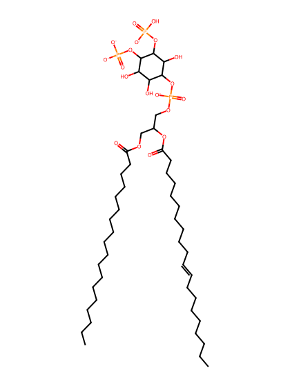
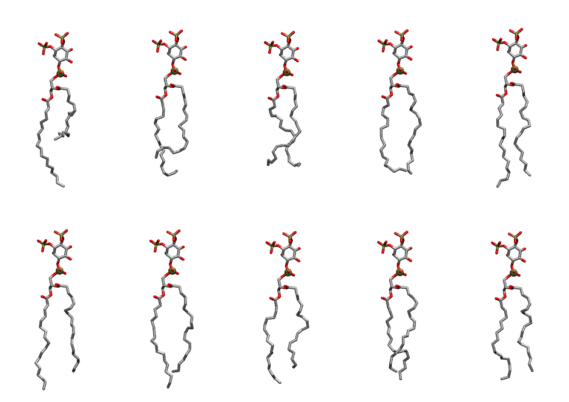

.. _lipid_gallery sapi2c:

SAPI2C
======

**Phosphatidylinositol-(3,4)-bisphosphate (PIP2) with protonation on P3**

==============  ===================================
CHARMM resname  ``SAPI2C``
Net charge      -4.00
Atoms           150
Topology file   ``toppar_all36_lipid_inositol.str``
Conformers      10 fluid
==============  ===================================

Structure
---------

Conformers
----------

The grid packer draws a conformer per lipid from this ensemble, so what the ensemble contains is what a built bilayer is made of. A leaflet declared ``phase: Lo`` generates an ordered ensemble when a build first needs it. All conformers are rendered at one shared scale.

=============  =============  ================  ================
Conformer      Head-tail (Å)  Max internal (Å)  Min chain extent
=============  =============  ================  ================
``SAPI2C-00``  8.58           33.87             0.45
``SAPI2C-01``  12.98          32.47             0.63
``SAPI2C-02``  14.28          29.90             0.65
``SAPI2C-03``  15.85          31.79             0.72
``SAPI2C-04``  17.13          35.02             0.81
``SAPI2C-05``  15.99          34.83             0.76
``SAPI2C-06``  16.03          34.61             0.76
``SAPI2C-07``  14.76          33.38             0.71
``SAPI2C-08``  15.75          32.59             0.75
``SAPI2C-09``  15.42          33.08             0.74
=============  =============  ================  ================

*Min chain extent* is how far the least-extended acyl chain descends below its own attachment carbon, as a fraction of that chain's all-trans contour; an all-trans chain scores 1.0, and a conformer under 0.25 is rejected at generation as folded.

Provenance
----------

How the ensemble was generated, read from the entry's own ``info.yaml``:

===================  ============
Setting              ``SAPI2C``
===================  ============
Sampler              ``mc``
Phase                none (fluid)
Trans bias           0.0
Chain order          0.217
MC seed              0
Chains               2
Cylinder APL         60.0 Ų
Cylinder inflation   1.9
Equilibration steps  20000
Decorrelation steps  3000
Max MC angle         30°
Radius scale         0.8
Axial bias           1.0
===================  ============
