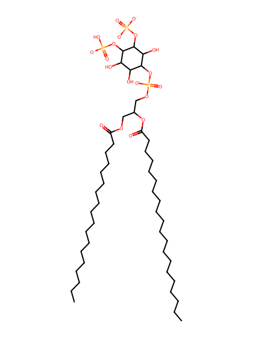
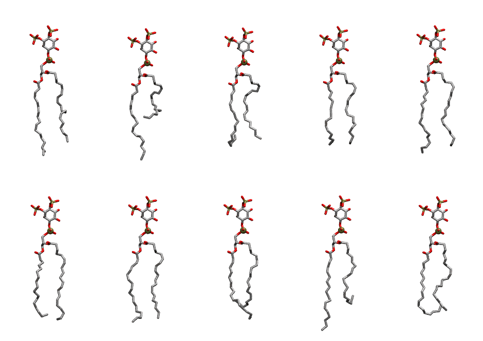

.. _lipid_gallery sapi2d:

SAPI2D
======

**Phosphatidylinositol-(3,4)-bisphosphate (PIP2) with protonation on P4**

==============  ===================================
CHARMM resname  ``SAPI2D``
Net charge      -4.00
Atoms           150
Topology file   ``toppar_all36_lipid_inositol.str``
Conformers      10 fluid
==============  ===================================

Structure
---------

Conformers
----------

The grid packer draws a conformer per lipid from this ensemble, so what the ensemble contains is what a built bilayer is made of. A leaflet declared ``phase: Lo`` generates an ordered ensemble when a build first needs it. All conformers are rendered at one shared scale.

=============  =============  ================  ================
Conformer      Head-tail (Å)  Max internal (Å)  Min chain extent
=============  =============  ================  ================
``SAPI2D-00``  15.41          33.93             0.73
``SAPI2D-01``  8.36           34.31             0.44
``SAPI2D-02``  13.31          31.53             0.60
``SAPI2D-03``  15.71          31.46             0.72
``SAPI2D-04``  16.43          33.66             0.78
``SAPI2D-05``  15.96          32.33             0.72
``SAPI2D-06``  16.89          33.47             0.80
``SAPI2D-07``  12.55          32.34             0.62
``SAPI2D-08``  11.42          35.83             0.57
``SAPI2D-09``  13.62          31.34             0.61
=============  =============  ================  ================

*Min chain extent* is how far the least-extended acyl chain descends below its own attachment carbon, as a fraction of that chain's all-trans contour; an all-trans chain scores 1.0, and a conformer under 0.25 is rejected at generation as folded.

Provenance
----------

How the ensemble was generated, read from the entry's own ``info.yaml``:

===================  ============
Setting              ``SAPI2D``
===================  ============
Sampler              ``mc``
Phase                none (fluid)
Trans bias           0.0
Chain order          0.195
MC seed              0
Chains               2
Cylinder APL         60.0 Ų
Cylinder inflation   1.9
Equilibration steps  20000
Decorrelation steps  3000
Max MC angle         30°
Radius scale         0.8
Axial bias           1.0
===================  ============
