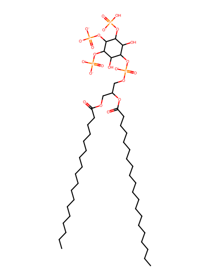
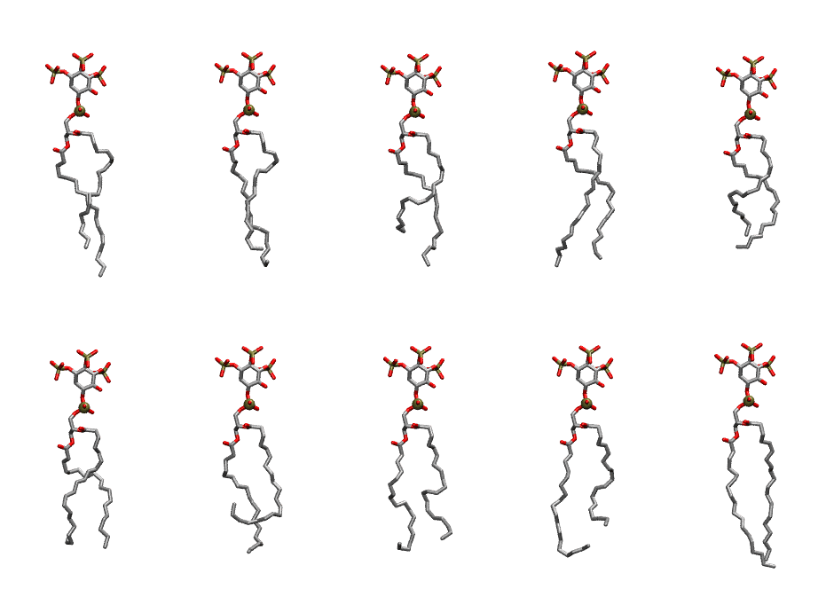

.. _lipid_gallery sapi33:

SAPI33
======

**Phosphatidylinositol-(3,4,5)-trisphosphate (PIP3) with protonation on P3**

==============  ===================================
CHARMM resname  ``SAPI33``
Net charge      -6.00
Atoms           153
Topology file   ``toppar_all36_lipid_inositol.str``
Conformers      10 fluid
==============  ===================================

Structure
---------

Conformers
----------

The grid packer draws a conformer per lipid from this ensemble, so what the ensemble contains is what a built bilayer is made of. A leaflet declared ``phase: Lo`` generates an ordered ensemble when a build first needs it. All conformers are rendered at one shared scale.

=============  =============  ================  ================
Conformer      Head-tail (Å)  Max internal (Å)  Min chain extent
=============  =============  ================  ================
``SAPI33-00``  14.10          32.96             0.68
``SAPI33-01``  14.46          31.64             0.70
``SAPI33-02``  11.00          31.01             0.55
``SAPI33-03``  15.90          31.91             0.72
``SAPI33-04``  11.84          28.65             0.59
``SAPI33-05``  12.70          29.27             0.62
``SAPI33-06``  8.88           30.32             0.47
``SAPI33-07``  13.82          30.49             0.66
``SAPI33-08``  11.88          31.53             0.59
``SAPI33-09``  17.30          33.40             0.82
=============  =============  ================  ================

*Min chain extent* is how far the least-extended acyl chain descends below its own attachment carbon, as a fraction of that chain's all-trans contour; an all-trans chain scores 1.0, and a conformer under 0.25 is rejected at generation as folded.

Provenance
----------

How the ensemble was generated, read from the entry's own ``info.yaml``:

===================  ============
Setting              ``SAPI33``
===================  ============
Sampler              ``mc``
Phase                none (fluid)
Trans bias           0.0
Chain order          0.152
MC seed              0
Chains               2
Cylinder APL         60.0 Ų
Cylinder inflation   1.9
Equilibration steps  20000
Decorrelation steps  3000
Max MC angle         30°
Radius scale         0.8
Axial bias           1.0
===================  ============
