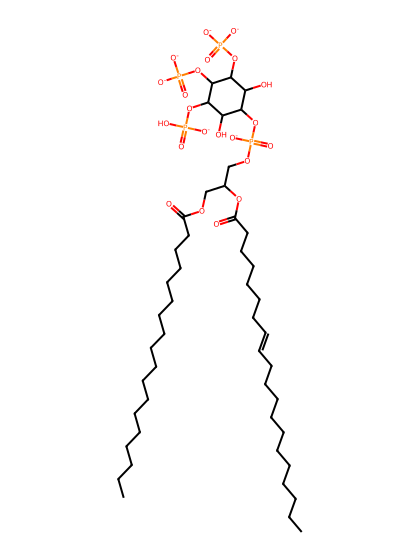
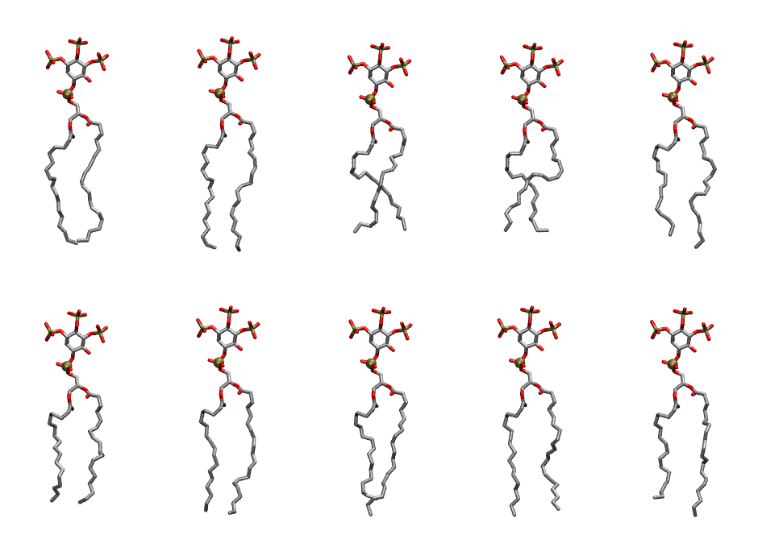

.. _lipid_gallery sapi35:

SAPI35
======

**Phosphatidylinositol-(3,4,5)-trisphosphate (PIP3) with protonation on P5**

==============  ===================================
CHARMM resname  ``SAPI35``
Net charge      -6.00
Atoms           153
Topology file   ``toppar_all36_lipid_inositol.str``
Conformers      10 fluid
==============  ===================================

Structure
---------

Conformers
----------

The grid packer draws a conformer per lipid from this ensemble, so what the ensemble contains is what a built bilayer is made of. A leaflet declared ``phase: Lo`` generates an ordered ensemble when a build first needs it. All conformers are rendered at one shared scale.

=============  =============  ================  ================
Conformer      Head-tail (Å)  Max internal (Å)  Min chain extent
=============  =============  ================  ================
``SAPI35-00``  16.12          33.16             0.76
``SAPI35-01``  17.35          34.05             0.82
``SAPI35-02``  13.50          30.16             0.64
``SAPI35-03``  13.67          30.11             0.65
``SAPI35-04``  14.76          32.82             0.70
``SAPI35-05``  14.25          30.77             0.68
``SAPI35-06``  16.30          33.09             0.77
``SAPI35-07``  14.35          32.77             0.68
``SAPI35-08``  16.09          33.29             0.76
``SAPI35-09``  14.09          32.80             0.67
=============  =============  ================  ================

*Min chain extent* is how far the least-extended acyl chain descends below its own attachment carbon, as a fraction of that chain's all-trans contour; an all-trans chain scores 1.0, and a conformer under 0.25 is rejected at generation as folded.

Provenance
----------

How the ensemble was generated, read from the entry's own ``info.yaml``:

===================  ============
Setting              ``SAPI35``
===================  ============
Sampler              ``mc``
Phase                none (fluid)
Trans bias           0.0
Chain order          0.217
MC seed              0
Chains               2
Cylinder APL         60.0 Ų
Cylinder inflation   1.9
Equilibration steps  20000
Decorrelation steps  3000
Max MC angle         30°
Radius scale         0.8
Axial bias           1.0
===================  ============
