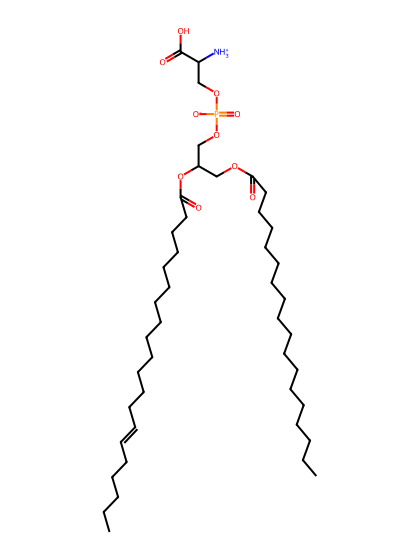
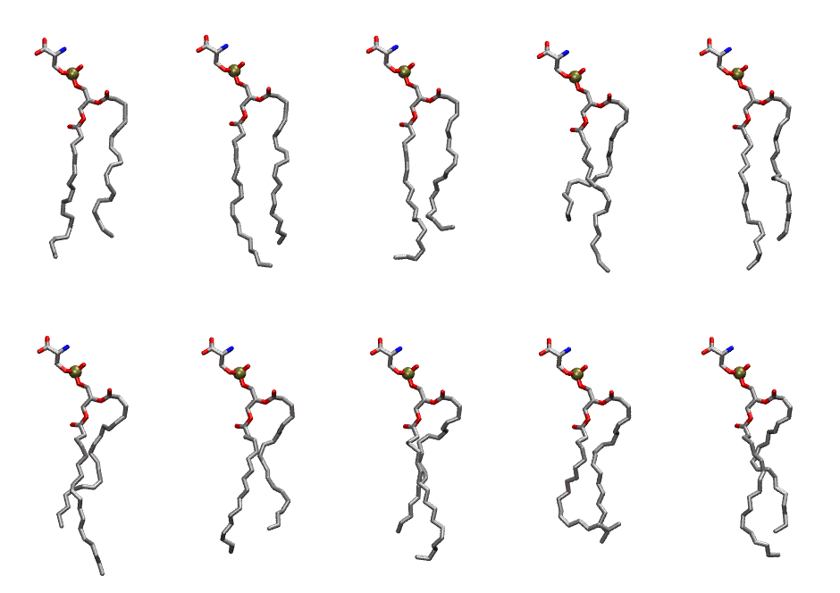

.. _lipid_gallery saps:

SAPS
====

**1-Stearoyl-2-Arachidonyl-Phosphatidylserine**

==============  ========================================
CHARMM resname  ``SAPS``
Net charge      -1.00
Atoms           133
Topology file   ``toppar_all36_lipid_miscellaneous.str``
Conformers      10 fluid
==============  ========================================

Structure
---------

Conformers
----------

The grid packer draws a conformer per lipid from this ensemble, so what the ensemble contains is what a built bilayer is made of. A leaflet declared ``phase: Lo`` generates an ordered ensemble when a build first needs it. All conformers are rendered at one shared scale.

===========  =============  ================  ================
Conformer    Head-tail (Å)  Max internal (Å)  Min chain extent
===========  =============  ================  ================
``SAPS-00``  13.82          28.55             0.73
``SAPS-01``  15.08          31.39             0.78
``SAPS-02``  12.97          29.59             0.69
``SAPS-03``  11.34          30.58             0.62
``SAPS-04``  14.18          30.25             0.74
``SAPS-05``  12.84          31.32             0.68
``SAPS-06``  12.96          27.88             0.69
``SAPS-07``  13.29          29.34             0.70
``SAPS-08``  12.29          27.61             0.57
``SAPS-09``  13.35          29.49             0.71
===========  =============  ================  ================

*Min chain extent* is how far the least-extended acyl chain descends below its own attachment carbon, as a fraction of that chain's all-trans contour; an all-trans chain scores 1.0, and a conformer under 0.25 is rejected at generation as folded.

Provenance
----------

How the ensemble was generated, read from the entry's own ``info.yaml``:

===================  ============
Setting              ``SAPS``
===================  ============
Sampler              ``mc``
Phase                none (fluid)
Trans bias           0.0
Chain order          0.194
MC seed              0
Chains               2
Cylinder APL         60.0 Ų
Cylinder inflation   1.9
Equilibration steps  20000
Decorrelation steps  3000
Max MC angle         30°
Radius scale         0.8
Axial bias           1.0
===================  ============
