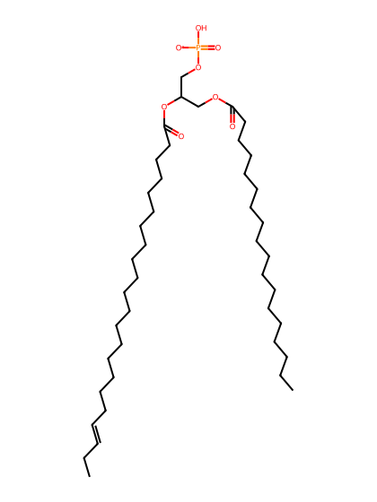
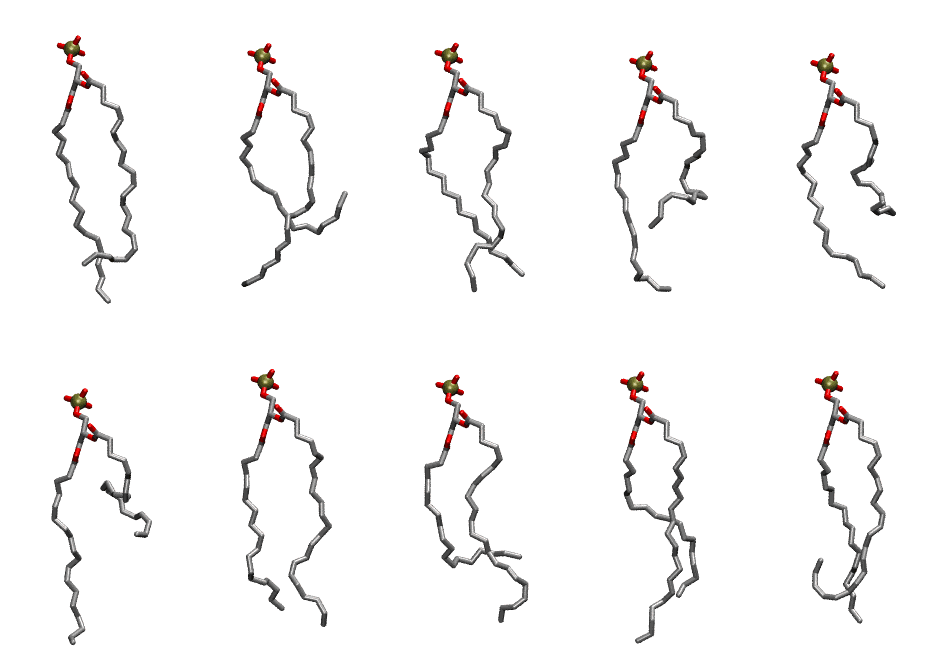

.. _lipid_gallery sdpa:

SDPA
====

**1-Stearoyl-2-Docosahexaenoyl-Phosphatidic acid**

==============  ========================================
CHARMM resname  ``SDPA``
Net charge      -1.00
Atoms           124
Topology file   ``toppar_all36_lipid_miscellaneous.str``
Conformers      10 fluid
==============  ========================================

Structure
---------

Conformers
----------

The grid packer draws a conformer per lipid from this ensemble, so what the ensemble contains is what a built bilayer is made of. A leaflet declared ``phase: Lo`` generates an ordered ensemble when a build first needs it. All conformers are rendered at one shared scale.

===========  =============  ================  ================
Conformer    Head-tail (Å)  Max internal (Å)  Min chain extent
===========  =============  ================  ================
``SDPA-00``  15.61          27.40             0.69
``SDPA-01``  7.81           24.84             0.35
``SDPA-02``  15.92          25.50             0.73
``SDPA-03``  10.33          25.02             0.49
``SDPA-04``  7.75           24.62             0.39
``SDPA-05``  7.35           25.96             0.38
``SDPA-06``  16.70          26.83             0.76
``SDPA-07``  10.97          25.67             0.50
``SDPA-08``  15.15          27.78             0.69
``SDPA-09``  11.75          26.56             0.54
===========  =============  ================  ================

*Min chain extent* is how far the least-extended acyl chain descends below its own attachment carbon, as a fraction of that chain's all-trans contour; an all-trans chain scores 1.0, and a conformer under 0.25 is rejected at generation as folded.

Provenance
----------

How the ensemble was generated, read from the entry's own ``info.yaml``:

===================  ============
Setting              ``SDPA``
===================  ============
Sampler              ``mc``
Phase                none (fluid)
Trans bias           0.0
Chain order          0.125
MC seed              0
Chains               2
Cylinder APL         60.0 Ų
Cylinder inflation   1.9
Equilibration steps  20000
Decorrelation steps  3000
Max MC angle         30°
Radius scale         0.8
Axial bias           1.0
===================  ============
