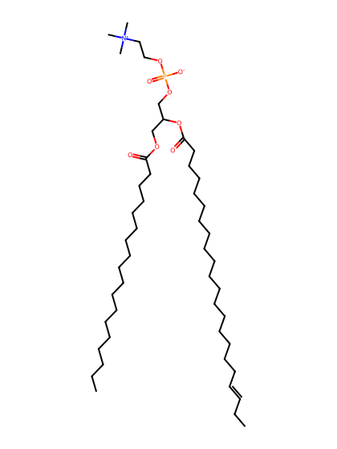
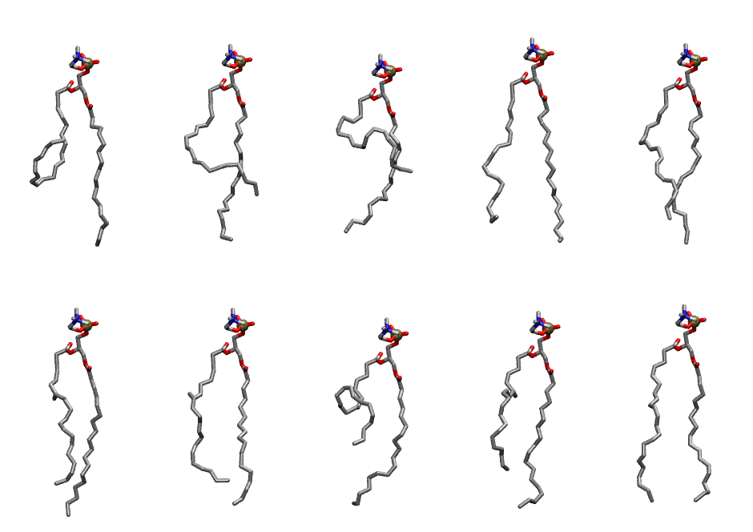

.. _lipid_gallery sdpc:

SDPC
====

**3-stearoyl-2-docosahexaenoyl-D-glycero-1-phosphatidylcholine**

==============  =======================
CHARMM resname  ``SDPC``
Net charge      0.00
Atoms           142
Topology file   ``top_all36_lipid.rtf``
Conformers      10 fluid
==============  =======================

Structure
---------

Conformers
----------

The grid packer draws a conformer per lipid from this ensemble, so what the ensemble contains is what a built bilayer is made of. A leaflet declared ``phase: Lo`` generates an ordered ensemble when a build first needs it. All conformers are rendered at one shared scale.

===========  =============  ================  ================
Conformer    Head-tail (Å)  Max internal (Å)  Min chain extent
===========  =============  ================  ================
``SDPC-00``  4.62           28.98             0.27
``SDPC-01``  12.22          27.80             0.55
``SDPC-02``  7.76           26.11             0.38
``SDPC-03``  16.14          29.04             0.70
``SDPC-04``  15.56          27.91             0.68
``SDPC-05``  15.65          29.71             0.68
``SDPC-06``  15.21          28.03             0.66
``SDPC-07``  8.92           27.69             0.43
``SDPC-08``  13.27          28.26             0.59
``SDPC-09``  18.41          28.55             0.78
===========  =============  ================  ================

*Min chain extent* is how far the least-extended acyl chain descends below its own attachment carbon, as a fraction of that chain's all-trans contour; an all-trans chain scores 1.0, and a conformer under 0.25 is rejected at generation as folded.

Provenance
----------

How the ensemble was generated, read from the entry's own ``info.yaml``:

===================  ============
Setting              ``SDPC``
===================  ============
Sampler              ``mc``
Phase                none (fluid)
Trans bias           0.0
Chain order          0.184
MC seed              0
Chains               2
Cylinder APL         60.0 Ų
Cylinder inflation   1.9
Equilibration steps  20000
Decorrelation steps  3000
Max MC angle         30°
Radius scale         0.8
Axial bias           1.0
===================  ============
