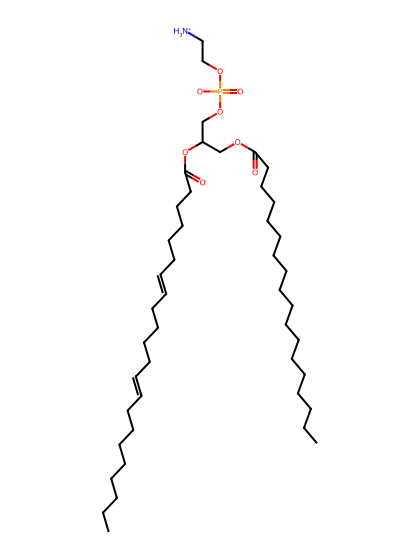
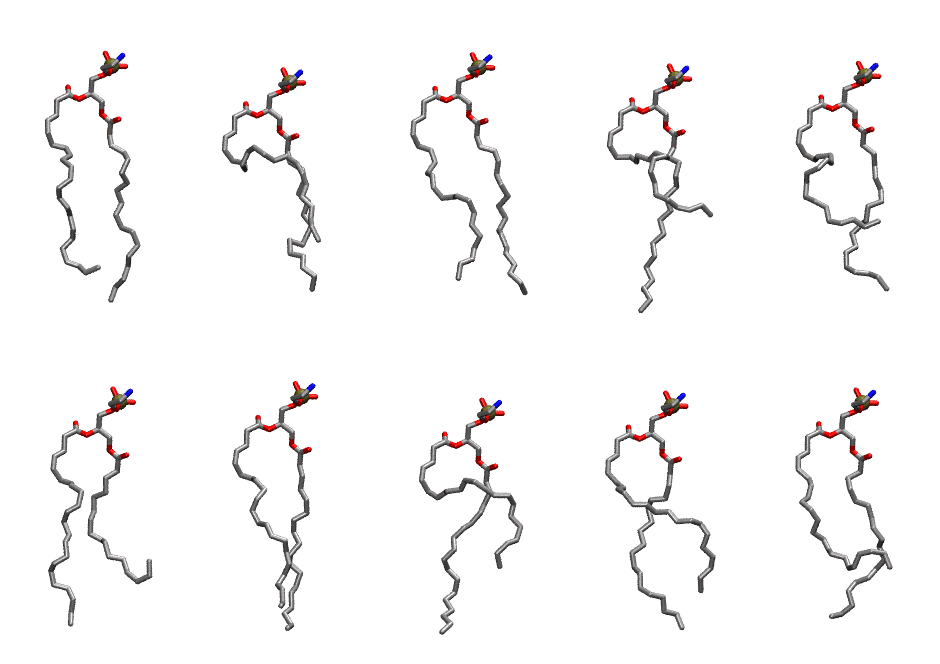

.. _lipid_gallery sdpe:

SDPE
====

**1-Stearoyl-2-Docosahexaenoyl-Phosphatidylethanolamine**

==============  ========================================
CHARMM resname  ``SDPE``
Net charge      0.00
Atoms           133
Topology file   ``toppar_all36_lipid_miscellaneous.str``
Conformers      10 fluid
==============  ========================================

Structure
---------

Conformers
----------

The grid packer draws a conformer per lipid from this ensemble, so what the ensemble contains is what a built bilayer is made of. A leaflet declared ``phase: Lo`` generates an ordered ensemble when a build first needs it. All conformers are rendered at one shared scale.

===========  =============  ================  ================
Conformer    Head-tail (Å)  Max internal (Å)  Min chain extent
===========  =============  ================  ================
``SDPE-00``  15.52          27.52             0.68
``SDPE-01``  10.90          24.36             0.50
``SDPE-02``  16.48          26.69             0.71
``SDPE-03``  8.66           27.33             0.42
``SDPE-04``  9.64           25.27             0.46
``SDPE-05``  11.13          26.86             0.50
``SDPE-06``  16.35          27.18             0.71
``SDPE-07``  10.48          26.46             0.49
``SDPE-08``  13.76          26.35             0.61
``SDPE-09``  11.62          25.59             0.53
===========  =============  ================  ================

*Min chain extent* is how far the least-extended acyl chain descends below its own attachment carbon, as a fraction of that chain's all-trans contour; an all-trans chain scores 1.0, and a conformer under 0.25 is rejected at generation as folded.

Provenance
----------

How the ensemble was generated, read from the entry's own ``info.yaml``:

===================  ============
Setting              ``SDPE``
===================  ============
Sampler              ``mc``
Phase                none (fluid)
Trans bias           0.0
Chain order          0.163
MC seed              0
Chains               2
Cylinder APL         60.0 Ų
Cylinder inflation   1.9
Equilibration steps  20000
Decorrelation steps  3000
Max MC angle         30°
Radius scale         0.8
Axial bias           1.0
===================  ============
