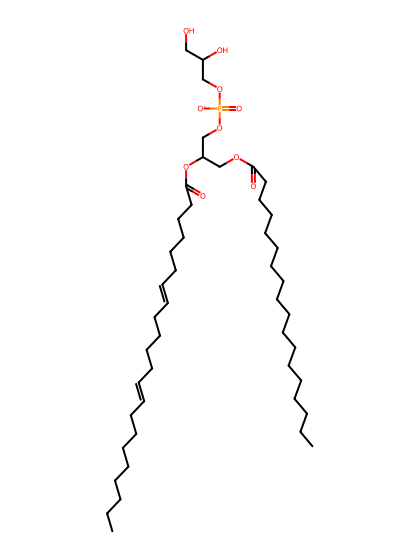
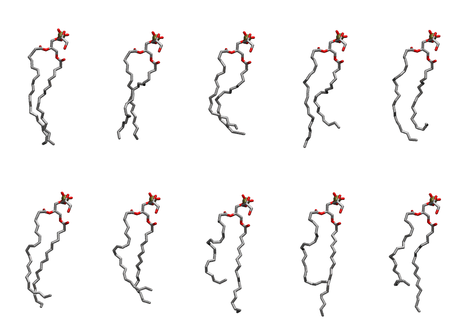

.. _lipid_gallery sdpg:

SDPG
====

**1-Stearoyl-2-Docosahexaenoyl-Phosphatidylglycerol**

==============  ========================================
CHARMM resname  ``SDPG``
Net charge      -1.00
Atoms           135
Topology file   ``toppar_all36_lipid_miscellaneous.str``
Conformers      10 fluid
==============  ========================================

Structure
---------

Conformers
----------

The grid packer draws a conformer per lipid from this ensemble, so what the ensemble contains is what a built bilayer is made of. A leaflet declared ``phase: Lo`` generates an ordered ensemble when a build first needs it. All conformers are rendered at one shared scale.

===========  =============  ================  ================
Conformer    Head-tail (Å)  Max internal (Å)  Min chain extent
===========  =============  ================  ================
``SDPG-00``  18.62          27.14             0.79
``SDPG-01``  16.77          26.39             0.72
``SDPG-02``  14.59          23.35             0.66
``SDPG-03``  14.63          27.78             0.66
``SDPG-04``  13.98          25.33             0.63
``SDPG-05``  16.08          26.88             0.69
``SDPG-06``  14.67          25.12             0.64
``SDPG-07``  12.03          26.81             0.54
``SDPG-08``  12.93          28.03             0.58
``SDPG-09``  13.39          27.56             0.59
===========  =============  ================  ================

*Min chain extent* is how far the least-extended acyl chain descends below its own attachment carbon, as a fraction of that chain's all-trans contour; an all-trans chain scores 1.0, and a conformer under 0.25 is rejected at generation as folded.

Provenance
----------

How the ensemble was generated, read from the entry's own ``info.yaml``:

===================  ============
Setting              ``SDPG``
===================  ============
Sampler              ``mc``
Phase                none (fluid)
Trans bias           0.0
Chain order          0.171
MC seed              0
Chains               2
Cylinder APL         60.0 Ų
Cylinder inflation   1.9
Equilibration steps  20000
Decorrelation steps  3000
Max MC angle         30°
Radius scale         0.8
Axial bias           1.0
===================  ============
