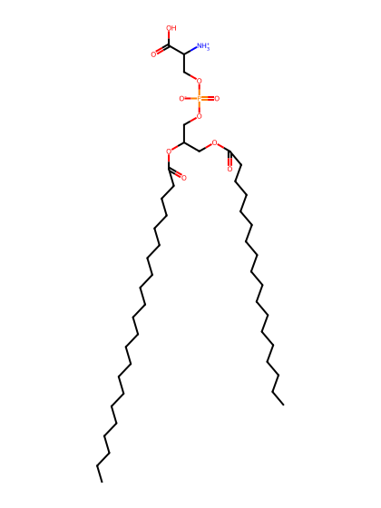
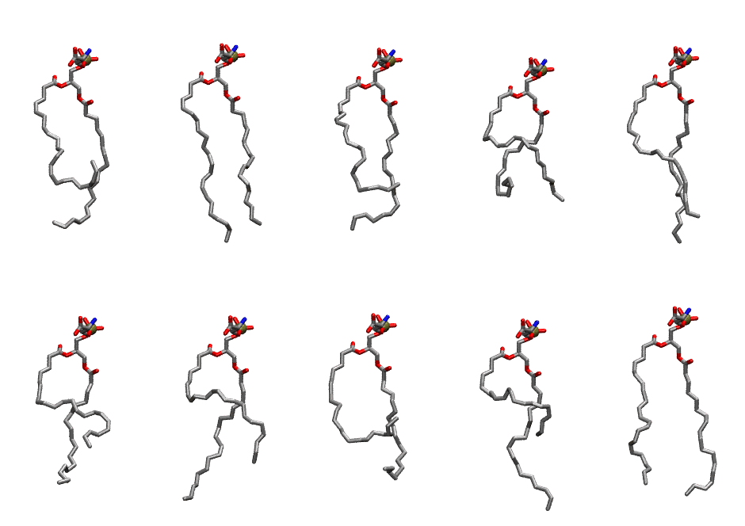

.. _lipid_gallery sdps:

SDPS
====

**1-Stearoyl-2-Docosahexaenoyl-Phosphatidylserine**

==============  ========================================
CHARMM resname  ``SDPS``
Net charge      -1.00
Atoms           135
Topology file   ``toppar_all36_lipid_miscellaneous.str``
Conformers      10 fluid
==============  ========================================

Structure
---------

Conformers
----------

The grid packer draws a conformer per lipid from this ensemble, so what the ensemble contains is what a built bilayer is made of. A leaflet declared ``phase: Lo`` generates an ordered ensemble when a build first needs it. All conformers are rendered at one shared scale.

===========  =============  ================  ================
Conformer    Head-tail (Å)  Max internal (Å)  Min chain extent
===========  =============  ================  ================
``SDPS-00``  8.00           25.38             0.39
``SDPS-01``  16.67          27.45             0.76
``SDPS-02``  10.85          25.81             0.50
``SDPS-03``  9.82           20.49             0.44
``SDPS-04``  15.31          27.17             0.67
``SDPS-05``  10.02          24.20             0.47
``SDPS-06``  12.14          26.85             0.55
``SDPS-07``  6.69           23.39             0.34
``SDPS-08``  8.11           26.64             0.40
``SDPS-09``  16.22          26.02             0.70
===========  =============  ================  ================

*Min chain extent* is how far the least-extended acyl chain descends below its own attachment carbon, as a fraction of that chain's all-trans contour; an all-trans chain scores 1.0, and a conformer under 0.25 is rejected at generation as folded.

Provenance
----------

How the ensemble was generated, read from the entry's own ``info.yaml``:

===================  ============
Setting              ``SDPS``
===================  ============
Sampler              ``mc``
Phase                none (fluid)
Trans bias           0.0
Chain order          0.138
MC seed              0
Chains               2
Cylinder APL         60.0 Ų
Cylinder inflation   1.9
Equilibration steps  20000
Decorrelation steps  3000
Max MC angle         30°
Radius scale         0.8
Axial bias           1.0
===================  ============
