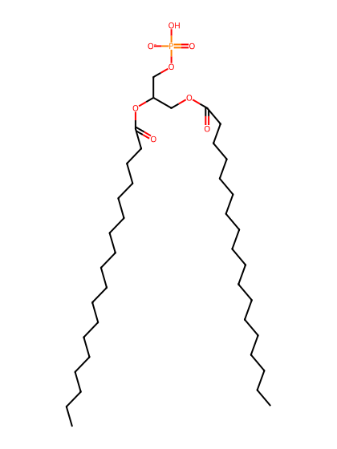
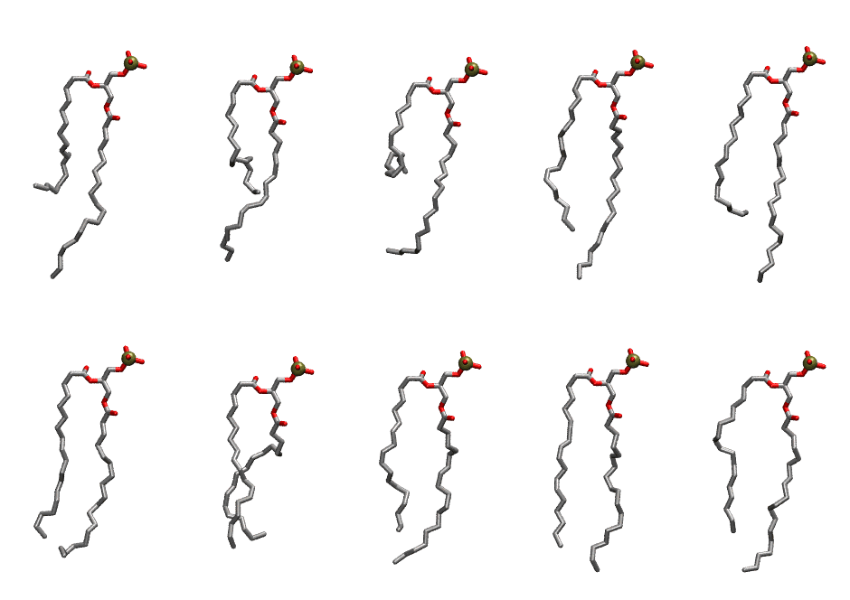

.. _lipid_gallery slpa:

SLPA
====

**1-Stearoyl-2-Linoleoyl-Phosphotidic acid**

==============  ========================================
CHARMM resname  ``SLPA``
Net charge      -1.00
Atoms           120
Topology file   ``toppar_all36_lipid_miscellaneous.str``
Conformers      10 fluid
==============  ========================================

Structure
---------

Conformers
----------

The grid packer draws a conformer per lipid from this ensemble, so what the ensemble contains is what a built bilayer is made of. A leaflet declared ``phase: Lo`` generates an ordered ensemble when a build first needs it. All conformers are rendered at one shared scale.

===========  =============  ================  ================
Conformer    Head-tail (Å)  Max internal (Å)  Min chain extent
===========  =============  ================  ================
``SLPA-00``  7.63           27.70             0.56
``SLPA-01``  7.87           25.38             0.57
``SLPA-02``  5.33           24.87             0.45
``SLPA-03``  12.63          27.15             0.79
``SLPA-04``  11.15          27.55             0.72
``SLPA-05``  13.89          25.68             0.75
``SLPA-06``  12.46          23.48             0.58
``SLPA-07``  12.58          26.03             0.76
``SLPA-08``  14.64          26.14             0.81
``SLPA-09``  12.72          26.58             0.80
===========  =============  ================  ================

*Min chain extent* is how far the least-extended acyl chain descends below its own attachment carbon, as a fraction of that chain's all-trans contour; an all-trans chain scores 1.0, and a conformer under 0.25 is rejected at generation as folded.

Provenance
----------

How the ensemble was generated, read from the entry's own ``info.yaml``:

===================  ============
Setting              ``SLPA``
===================  ============
Sampler              ``mc``
Phase                none (fluid)
Trans bias           0.0
Chain order          0.220
MC seed              0
Chains               2
Cylinder APL         60.0 Ų
Cylinder inflation   1.9
Equilibration steps  20000
Decorrelation steps  3000
Max MC angle         30°
Radius scale         0.8
Axial bias           1.0
===================  ============
