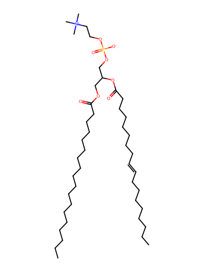
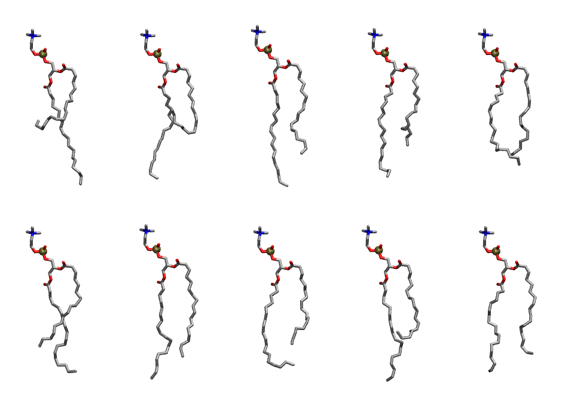

.. _lipid_gallery slpc:

SLPC
====

**1-Stearoyl-2-Linoleoyl-Phosphatidylcholine**

==============  ========================================
CHARMM resname  ``SLPC``
Net charge      0.00
Atoms           138
Topology file   ``toppar_all36_lipid_miscellaneous.str``
Conformers      10 fluid
==============  ========================================

Structure
---------

Conformers
----------

The grid packer draws a conformer per lipid from this ensemble, so what the ensemble contains is what a built bilayer is made of. A leaflet declared ``phase: Lo`` generates an ordered ensemble when a build first needs it. All conformers are rendered at one shared scale.

===========  =============  ================  ================
Conformer    Head-tail (Å)  Max internal (Å)  Min chain extent
===========  =============  ================  ================
``SLPC-00``  6.71           33.12             0.48
``SLPC-01``  4.55           30.93             0.38
``SLPC-02``  13.80          33.58             0.81
``SLPC-03``  11.58          31.06             0.71
``SLPC-04``  13.67          29.59             0.71
``SLPC-05``  12.09          31.37             0.73
``SLPC-06``  14.53          31.72             0.84
``SLPC-07``  11.67          30.04             0.71
``SLPC-08``  9.62           32.45             0.62
``SLPC-09``  13.59          30.16             0.79
===========  =============  ================  ================

*Min chain extent* is how far the least-extended acyl chain descends below its own attachment carbon, as a fraction of that chain's all-trans contour; an all-trans chain scores 1.0, and a conformer under 0.25 is rejected at generation as folded.

Provenance
----------

How the ensemble was generated, read from the entry's own ``info.yaml``:

===================  ============
Setting              ``SLPC``
===================  ============
Sampler              ``mc``
Phase                none (fluid)
Trans bias           0.0
Chain order          0.232
MC seed              0
Chains               2
Cylinder APL         60.0 Ų
Cylinder inflation   1.9
Equilibration steps  20000
Decorrelation steps  3000
Max MC angle         30°
Radius scale         0.8
Axial bias           1.0
===================  ============
