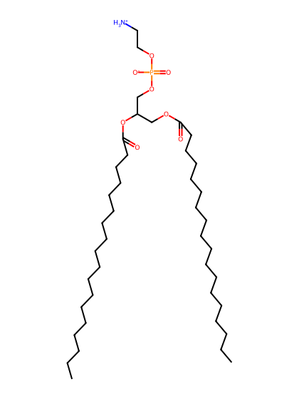
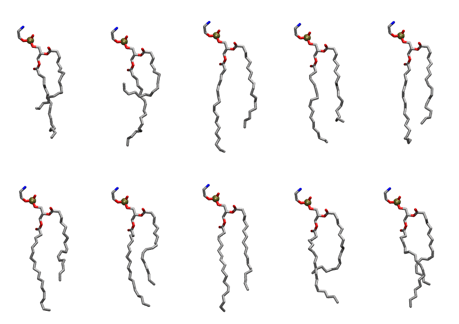

.. _lipid_gallery slpe:

SLPE
====

**1-Stearoyl-2-Linoleoyl-Phosphatidylethanolamine**

==============  ========================================
CHARMM resname  ``SLPE``
Net charge      0.00
Atoms           129
Topology file   ``toppar_all36_lipid_miscellaneous.str``
Conformers      10 fluid
==============  ========================================

Structure
---------

Conformers
----------

The grid packer draws a conformer per lipid from this ensemble, so what the ensemble contains is what a built bilayer is made of. A leaflet declared ``phase: Lo`` generates an ordered ensemble when a build first needs it. All conformers are rendered at one shared scale.

===========  =============  ================  ================
Conformer    Head-tail (Å)  Max internal (Å)  Min chain extent
===========  =============  ================  ================
``SLPE-00``  8.88           28.07             0.60
``SLPE-01``  3.08           28.06             0.33
``SLPE-02``  14.23          31.32             0.85
``SLPE-03``  12.47          29.75             0.77
``SLPE-04``  13.33          29.62             0.78
``SLPE-05``  11.51          30.40             0.72
``SLPE-06``  12.19          30.14             0.75
``SLPE-07``  14.08          30.51             0.84
``SLPE-08``  9.46           29.22             0.63
``SLPE-09``  12.13          29.09             0.75
===========  =============  ================  ================

*Min chain extent* is how far the least-extended acyl chain descends below its own attachment carbon, as a fraction of that chain's all-trans contour; an all-trans chain scores 1.0, and a conformer under 0.25 is rejected at generation as folded.

Provenance
----------

How the ensemble was generated, read from the entry's own ``info.yaml``:

===================  ============
Setting              ``SLPE``
===================  ============
Sampler              ``mc``
Phase                none (fluid)
Trans bias           0.0
Chain order          0.223
MC seed              0
Chains               2
Cylinder APL         60.0 Ų
Cylinder inflation   1.9
Equilibration steps  20000
Decorrelation steps  3000
Max MC angle         30°
Radius scale         0.8
Axial bias           1.0
===================  ============
