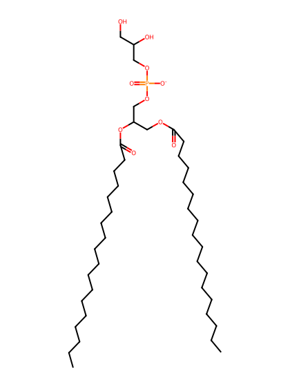
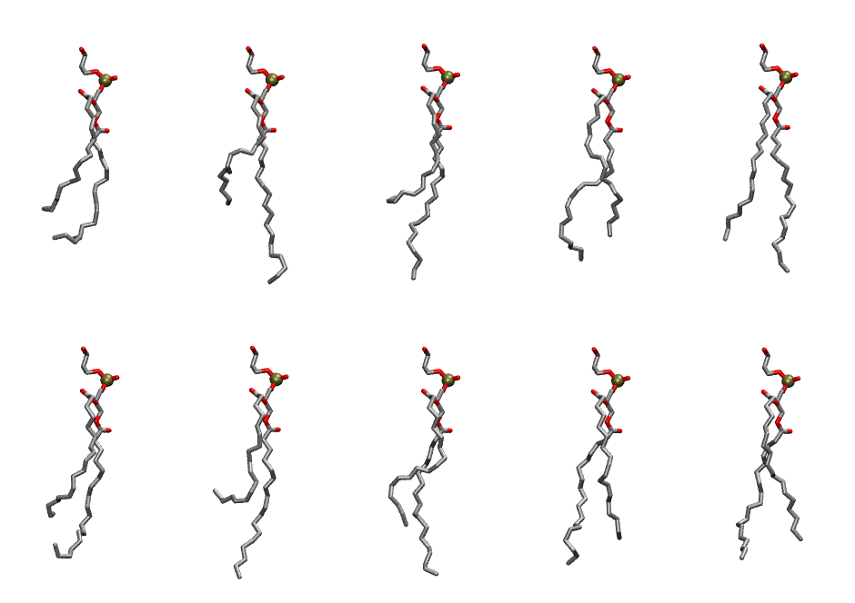

.. _lipid_gallery slpg:

SLPG
====

**1-Stearoyl-2-Linoleoyl-Phosphatidylglycerol**

==============  ========================================
CHARMM resname  ``SLPG``
Net charge      -1.00
Atoms           131
Topology file   ``toppar_all36_lipid_miscellaneous.str``
Conformers      10 fluid
==============  ========================================

Structure
---------

Conformers
----------

The grid packer draws a conformer per lipid from this ensemble, so what the ensemble contains is what a built bilayer is made of. A leaflet declared ``phase: Lo`` generates an ordered ensemble when a build first needs it. All conformers are rendered at one shared scale.

===========  =============  ================  ================
Conformer    Head-tail (Å)  Max internal (Å)  Min chain extent
===========  =============  ================  ================
``SLPG-00``  9.53           26.26             0.61
``SLPG-01``  9.04           29.70             0.61
``SLPG-02``  9.04           29.96             0.61
``SLPG-03``  12.93          26.98             0.74
``SLPG-04``  13.73          29.99             0.82
``SLPG-05``  10.27          27.56             0.66
``SLPG-06``  7.54           29.65             0.54
``SLPG-07``  11.59          29.03             0.73
``SLPG-08``  13.16          27.58             0.75
``SLPG-09``  13.26          27.99             0.72
===========  =============  ================  ================

*Min chain extent* is how far the least-extended acyl chain descends below its own attachment carbon, as a fraction of that chain's all-trans contour; an all-trans chain scores 1.0, and a conformer under 0.25 is rejected at generation as folded.

Provenance
----------

How the ensemble was generated, read from the entry's own ``info.yaml``:

===================  ============
Setting              ``SLPG``
===================  ============
Sampler              ``mc``
Phase                none (fluid)
Trans bias           0.0
Chain order          0.186
MC seed              0
Chains               2
Cylinder APL         60.0 Ų
Cylinder inflation   1.9
Equilibration steps  20000
Decorrelation steps  3000
Max MC angle         30°
Radius scale         0.8
Axial bias           1.0
===================  ============
