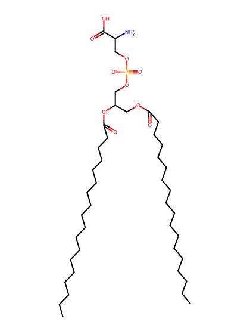
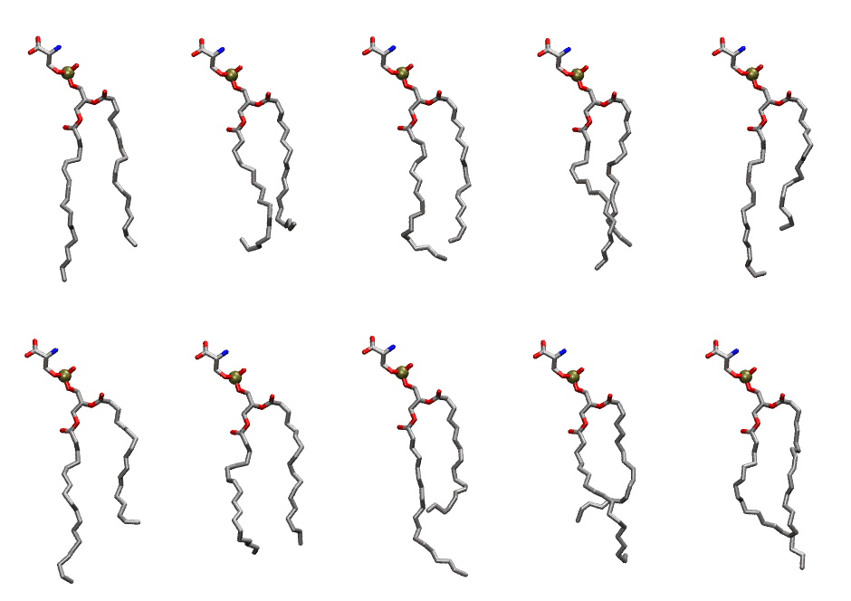

.. _lipid_gallery slps:

SLPS
====

**1-Stearoyl-2-Linoleoyl-Phosphatidylserine**

==============  ========================================
CHARMM resname  ``SLPS``
Net charge      -1.00
Atoms           131
Topology file   ``toppar_all36_lipid_miscellaneous.str``
Conformers      10 fluid
==============  ========================================

Structure
---------

Conformers
----------

The grid packer draws a conformer per lipid from this ensemble, so what the ensemble contains is what a built bilayer is made of. A leaflet declared ``phase: Lo`` generates an ordered ensemble when a build first needs it. All conformers are rendered at one shared scale.

===========  =============  ================  ================
Conformer    Head-tail (Å)  Max internal (Å)  Min chain extent
===========  =============  ================  ================
``SLPS-00``  14.27          30.11             0.83
``SLPS-01``  11.46          27.11             0.62
``SLPS-02``  13.73          29.32             0.73
``SLPS-03``  13.97          29.09             0.78
``SLPS-04``  12.14          30.18             0.73
``SLPS-05``  11.16          30.61             0.69
``SLPS-06``  13.49          27.80             0.67
``SLPS-07``  10.12          31.83             0.64
``SLPS-08``  10.82          29.23             0.67
``SLPS-09``  12.68          30.27             0.76
===========  =============  ================  ================

*Min chain extent* is how far the least-extended acyl chain descends below its own attachment carbon, as a fraction of that chain's all-trans contour; an all-trans chain scores 1.0, and a conformer under 0.25 is rejected at generation as folded.

Provenance
----------

How the ensemble was generated, read from the entry's own ``info.yaml``:

===================  ============
Setting              ``SLPS``
===================  ============
Sampler              ``mc``
Phase                none (fluid)
Trans bias           0.0
Chain order          0.197
MC seed              0
Chains               2
Cylinder APL         60.0 Ų
Cylinder inflation   1.9
Equilibration steps  20000
Decorrelation steps  3000
Max MC angle         30°
Radius scale         0.8
Axial bias           1.0
===================  ============
