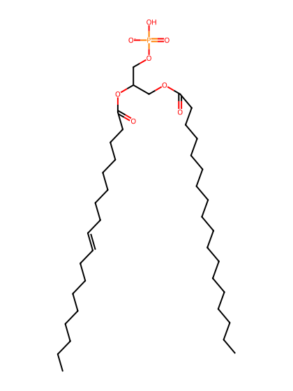
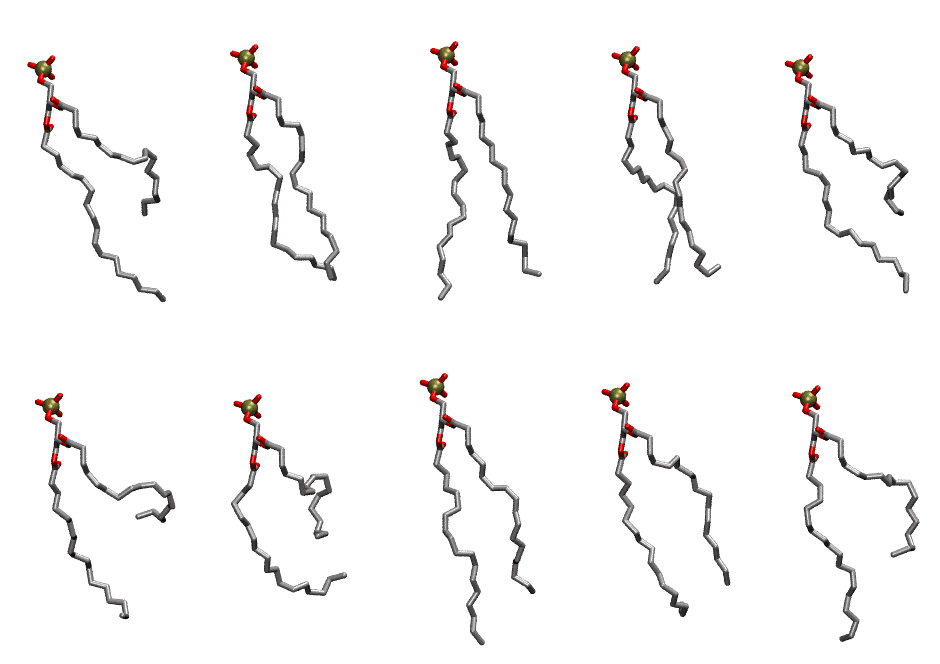

.. _lipid_gallery sopa:

SOPA
====

**1-Stearoyl-2-Oleoyl-Phosphatidic acid**

==============  ========================================
CHARMM resname  ``SOPA``
Net charge      -1.00
Atoms           122
Topology file   ``toppar_all36_lipid_miscellaneous.str``
Conformers      10 fluid
==============  ========================================

Structure
---------

Conformers
----------

The grid packer draws a conformer per lipid from this ensemble, so what the ensemble contains is what a built bilayer is made of. A leaflet declared ``phase: Lo`` generates an ordered ensemble when a build first needs it. All conformers are rendered at one shared scale.

===========  =============  ================  ================
Conformer    Head-tail (Å)  Max internal (Å)  Min chain extent
===========  =============  ================  ================
``SOPA-00``  8.33           26.75             0.48
``SOPA-01``  15.56          24.96             0.70
``SOPA-02``  15.49          25.17             0.80
``SOPA-03``  14.35          24.39             0.71
``SOPA-04``  8.41           25.50             0.48
``SOPA-05``  5.05           23.91             0.33
``SOPA-06``  6.81           22.53             0.41
``SOPA-07``  14.11          26.78             0.75
``SOPA-08``  12.40          24.64             0.67
``SOPA-09``  9.40           26.40             0.53
===========  =============  ================  ================

*Min chain extent* is how far the least-extended acyl chain descends below its own attachment carbon, as a fraction of that chain's all-trans contour; an all-trans chain scores 1.0, and a conformer under 0.25 is rejected at generation as folded.

Provenance
----------

How the ensemble was generated, read from the entry's own ``info.yaml``:

===================  ============
Setting              ``SOPA``
===================  ============
Sampler              ``mc``
Phase                none (fluid)
Trans bias           0.0
Chain order          0.127
MC seed              0
Chains               2
Cylinder APL         60.0 Ų
Cylinder inflation   1.9
Equilibration steps  20000
Decorrelation steps  3000
Max MC angle         30°
Radius scale         0.8
Axial bias           1.0
===================  ============
