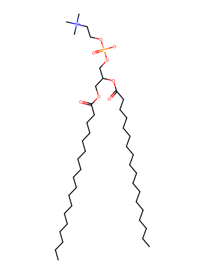
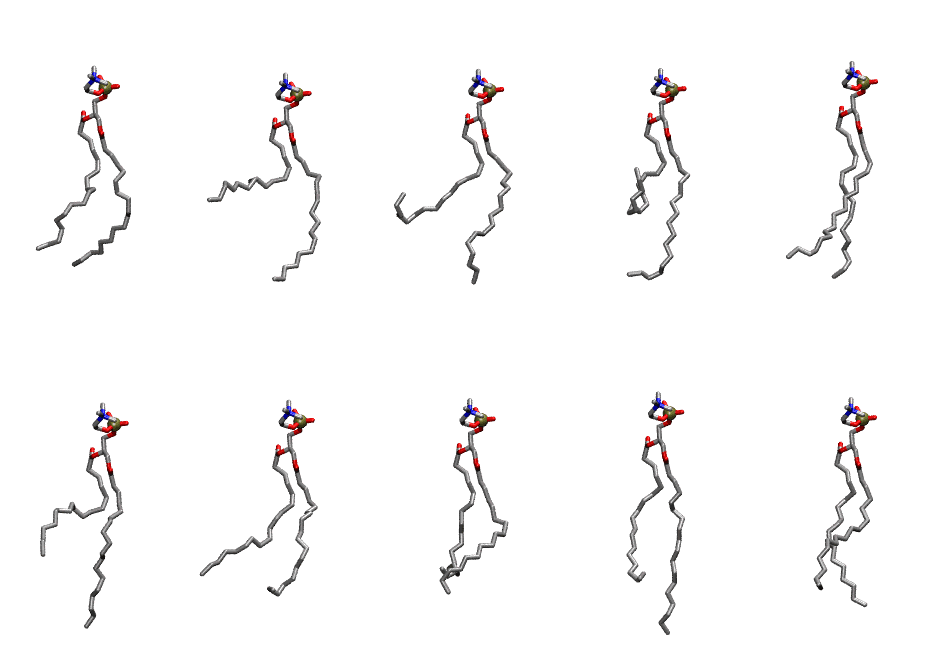

.. _lipid_gallery sopc:

SOPC
====

**3-stearoyl-2-oleoyl-D-glycero-1-phosphatidylcholine**

==============  =======================
CHARMM resname  ``SOPC``
Net charge      0.00
Atoms           140
Topology file   ``top_all36_lipid.rtf``
Conformers      10 fluid
==============  =======================

Structure
---------

Conformers
----------

The grid packer draws a conformer per lipid from this ensemble, so what the ensemble contains is what a built bilayer is made of. A leaflet declared ``phase: Lo`` generates an ordered ensemble when a build first needs it. All conformers are rendered at one shared scale.

===========  =============  ================  ================
Conformer    Head-tail (Å)  Max internal (Å)  Min chain extent
===========  =============  ================  ================
``SOPC-00``  13.49          25.72             0.69
``SOPC-01``  6.99           26.80             0.39
``SOPC-02``  6.82           26.44             0.39
``SOPC-03``  3.98           26.20             0.25
``SOPC-04``  15.02          27.02             0.67
``SOPC-05``  9.85           27.55             0.53
``SOPC-06``  12.51          25.05             0.64
``SOPC-07``  12.08          24.93             0.63
``SOPC-08``  13.98          29.69             0.72
``SOPC-09``  14.06          26.04             0.63
===========  =============  ================  ================

*Min chain extent* is how far the least-extended acyl chain descends below its own attachment carbon, as a fraction of that chain's all-trans contour; an all-trans chain scores 1.0, and a conformer under 0.25 is rejected at generation as folded.

Provenance
----------

How the ensemble was generated, read from the entry's own ``info.yaml``:

===================  ============
Setting              ``SOPC``
===================  ============
Sampler              ``mc``
Phase                none (fluid)
Trans bias           0.0
Chain order          0.137
MC seed              0
Chains               2
Cylinder APL         60.0 Ų
Cylinder inflation   1.9
Equilibration steps  20000
Decorrelation steps  3000
Max MC angle         30°
Radius scale         0.8
Axial bias           1.0
===================  ============
