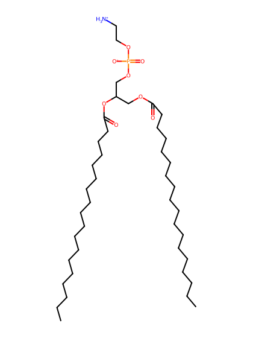
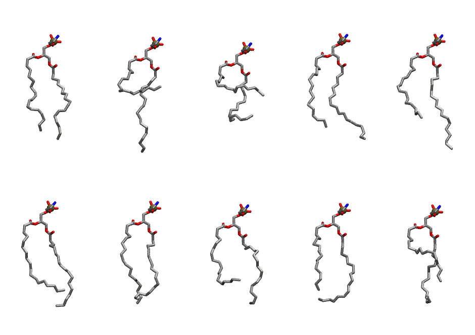
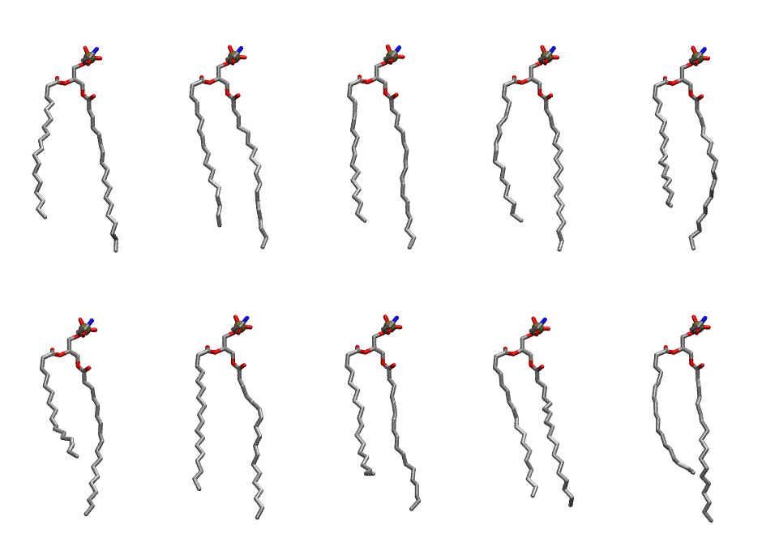

.. _lipid_gallery sope:

SOPE
====

**1-Stearoyl-2-Oleoyl-Phosphatidylethanolamine**

==============  ==========================================
CHARMM resname  ``SOPE``
Net charge      0.00
Atoms           131
Topology file   ``toppar_all36_lipid_miscellaneous.str``
Conformers      10 fluid, 10 liquid-ordered (``SOPE__Lo``)
==============  ==========================================

Structure
---------

Conformers
----------

The grid packer draws a conformer per lipid from an ensemble, so what the ensemble contains is what a built bilayer is made of. SOPE ships two: a fluid one, used by default, and a liquid-ordered one, used for a leaflet declared ``phase: Lo``. All conformers on this page are rendered at one shared scale.

Fluid (``SOPE``)
~~~~~~~~~~~~~~~~

===========  =============  ================  ================
Conformer    Head-tail (Å)  Max internal (Å)  Min chain extent
===========  =============  ================  ================
``SOPE-00``  14.11          25.16             0.72
``SOPE-01``  4.06           26.40             0.28
``SOPE-02``  4.77           20.58             0.31
``SOPE-03``  13.49          24.57             0.71
``SOPE-04``  11.42          26.54             0.62
``SOPE-05``  12.65          25.14             0.67
``SOPE-06``  14.53          24.04             0.65
``SOPE-07``  9.78           23.09             0.54
``SOPE-08``  12.06          23.34             0.63
``SOPE-09``  9.82           22.70             0.54
===========  =============  ================  ================

Liquid-ordered (``SOPE__Lo``)
~~~~~~~~~~~~~~~~~~~~~~~~~~~~~

===========  =============  ================  ================
Conformer    Head-tail (Å)  Max internal (Å)  Min chain extent
===========  =============  ================  ================
``SOPE-00``  16.40          28.86             0.85
``SOPE-01``  17.61          29.11             0.90
``SOPE-02``  17.07          29.12             0.88
``SOPE-03``  16.98          29.35             0.88
``SOPE-04``  14.84          28.88             0.78
``SOPE-05``  11.99          28.33             0.64
``SOPE-06``  16.81          28.95             0.87
``SOPE-07``  14.73          28.31             0.77
``SOPE-08``  17.48          27.28             0.85
``SOPE-09``  14.57          29.34             0.76
===========  =============  ================  ================

*Min chain extent* is how far the least-extended acyl chain descends below its own attachment carbon, as a fraction of that chain's all-trans contour; an all-trans chain scores 1.0, and a conformer under 0.25 is rejected at generation as folded.

Provenance
----------

How each ensemble was generated, read from the entry's own ``info.yaml``:

===================  ============  ============
Setting              ``SOPE``      ``SOPE__Lo``
===================  ============  ============
Sampler              ``mc``        ``mc``
Phase                none (fluid)  Lo
Trans bias           0.0           10.0
Chain order          0.103         0.303
MC seed              0             0
Chains               2             2
Cylinder APL         60.0 Ų       60.0 Ų
Cylinder inflation   1.9           1.9
Equilibration steps  20000         20000
Decorrelation steps  3000          3000
Max MC angle         30°           30°
Radius scale         0.8           0.8
Axial bias           1.0           1.0
===================  ============  ============
